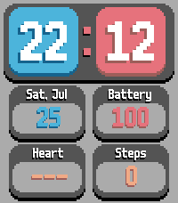

<!-- Generated by scripts/update_app_directory.py: do not edit by hand -->
[← All Pebble Developers](../developers.md)

# yannyfox

*1 watchface · Last updated 2026-10-12 · [About these lists](../about-app-lists.md)*

Links: [Pebble App Store](https://apps.repebble.com/apps/dev/yannyfox_6a656a4dd7f034000804f0f1) · [GitLab (yannyfox)](https://gitlab.com/yannyfox)

<h2 class="app-name" id="app-6a656dad55030a000901ea38"><a href="https://apps.repebble.com/6a656dad55030a000901ea38">Balatro-style Watchface</a> v0.1</h2>
<a class="app-source" href="https://gitlab.com/yannyfox/balatro-watchface" title="Source code" data-search-exclude>View source</a>

Watchface

Released 2026-07-26 Updated 2026-07-26

Runs on: Time 2

Balatro UI inspired watchface featuring the original font from the game, as well as health tracking. Currently only for the Pebble Time 2. This watchface is still in development, to make it more…

