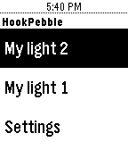

<!-- Generated by scripts/update_app_directory.py: do not edit by hand -->
[← All Pebble Developers](../developers.md)

# Yaoyu Yang

*1 app · Last updated 2026-10-11 · [About these lists](../about-app-lists.md)*

Links: [Pebble App Store](https://apps.repebble.com/apps/dev/yaoyu-yang_550cbee5deb0adbde6000074) · [Website (gethookio.strikingly.com)](http://gethookio.strikingly.com/)

<h2 class="app-name" id="app-5727044991da39820e000002"><a href="https://apps.repebble.com/5727044991da39820e000002">Hook</a> v0.1</h2>
<a class="app-source" href="http://www.yaoyuyang.com/" title="Source code" data-search-exclude>View source</a>

App

Released 2016-05-02 Updated 2016-05-03

Runs on: Round 2, Time 2, Pebble 2 Duo, Pebble 2, Time Round, Time, Classic

Control your Hook devices on Pebble watch!

