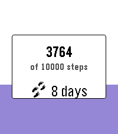

<!-- Generated by scripts/update_app_directory.py: do not edit by hand -->
[← All Pebble Developers](../developers.md)

# Yaron Sheffer

*1 app · Last updated 2026-10-11 · [About these lists](../about-app-lists.md)*

Links: [Pebble App Store](https://apps.repebble.com/apps/dev/yaron-sheffer_96a692ff40490c816176095f) · [GitHub (yaronf)](https://github.com/yaronf)

<h2 class="app-name" id="app-ec357a2a9d6f439e813f5429"><a href="https://apps.repebble.com/ec357a2a9d6f439e813f5429">Step Goals Plus</a> v2.1.0</h2>
<a class="app-source" href="https://github.com/yaronf/Pebble-Step-Goals-Plus" title="Source code" data-search-exclude>View source</a>

App

Released 2026-08-15 Updated 2026-08-29

Runs on: Round 2, Time 2, Time Round, Time

Track daily steps with a live progress fill, streak counting, bonus goals, and mid-goal encouragements — built for Pebble Time, Time Round, and Pebble Time 2 (Emery). Open the app to see today’s…

