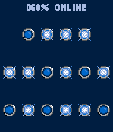

<!-- Generated by scripts/update_app_directory.py: do not edit by hand -->
[← All Pebble Developers](../developers.md)

# Yasuaki Gohko

*1 watchface · Last updated 2026-10-11 · [About these lists](../about-app-lists.md)*

Links: [Pebble App Store](https://apps.repebble.com/apps/dev/yasuaki-gohko_5324321ad7d0f25cf500039b)

<h2 class="app-name" id="app-5694d958bc80b99927000042"><a href="https://apps.repebble.com/5694d958bc80b99927000042">GBinary</a> v1.0</h2>
<a class="app-source" href="https://bitbucket.org/ygohko/gbinary/" title="Source code" data-search-exclude>View source</a>

Watchface

Released 2016-01-12 Updated 2016-01-12

Runs on: Time 2, Time

GBinary is a simple binary watchface for Pebble Time.

