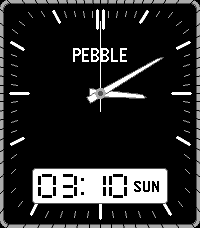

<!-- Generated by scripts/update_app_directory.py: do not edit by hand -->
[← All Pebble Developers](../developers.md)

# yaymanloopey

*1 watchface · Last updated 2026-10-12 · [About these lists](../about-app-lists.md)*

Links: [Pebble App Store](https://apps.repebble.com/apps/dev/yaymanloopey_3e373b0ea1325cb0cdbf2d35) · [GitHub (Yaymanloopey)](https://github.com/Yaymanloopey)

<h2 class="app-name" id="app-2d6f5087c71341d9902ed6cc"><a href="https://apps.repebble.com/2d6f5087c71341d9902ed6cc">Casio AnaDigi</a> v1.0.3</h2>
<a class="app-source" href="https://github.com/Yaymanloopey/pebble-ana-digi-face" title="Source code" data-search-exclude>View source</a>

Watchface

No licence Released 2026-08-02 Updated 2026-08-02

Runs on: Round 2, Time 2

Fork of Ana-digi Vibez Eric Migicovsky

