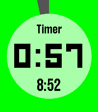
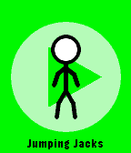

<!-- Generated by scripts/update_app_directory.py: do not edit by hand -->
[← All Pebble Developers](../developers.md)

# Ycleptic Studios

*2 apps · Last updated 2026-10-12 · [About these lists](../about-app-lists.md)*

Links: [Pebble App Store](https://apps.repebble.com/apps/dev/ycleptic-studios_54426f7688962ca0020000b2) · [GitHub (YclepticStudios)](https://github.com/YclepticStudios) · [Website (bit.ly)](http://bit.ly/YS7MinutePlus)

<button type="button" data-filter="all" aria-pressed="true">All 2</button><button type="button" data-filter="watchface" aria-pressed="false" disabled>Watchfaces 0</button><button type="button" data-filter="watchapp" aria-pressed="false">Apps 2</button>

<label class="dev-sort">Sort by <select><option value="updated">Recently updated</option><option value="released">Newest release</option><option value="title">A–Z</option></select></label>

<h2 class="app-name" id="app-54a1ba1afc5f23e4c000012d"><a href="https://apps.repebble.com/54a1ba1afc5f23e4c000012d">Timer+</a> v4.3</h2>
<a class="app-source" href="https://github.com/YclepticStudios/pebble-timer-plus" title="Source code" data-search-exclude>View source</a>

App · <a href="https://forum.rebble.io/t/730" title="Discuss this app on the Rebble forum" data-search-exclude>Forum thread</a>

MIT Released 2014-12-29 Updated 2026-03-03

Runs on: Round 2, Time 2, Pebble 2 Duo, Pebble 2, Time Round, Time, Classic

Timer+ is a beautifully animated, simple timer and stopwatch for your Pebble! It keeps track of your timer even after you close the app and will open the app when the timer has elapsed. Some…

<h2 class="app-name" id="app-55c6658f65af420a55000043"><a href="https://apps.repebble.com/55c6658f65af420a55000043">7-Minute+</a> v1.1-rbl1</h2>
<a class="app-source" href="https://github.com/YclepticStudios/pebble-7-min" title="Source code" data-search-exclude>View source</a>

App

MIT Released 2015-08-08 Updated 2019-07-24

Runs on: Round 2, Time 2, Pebble 2 Duo, Pebble 2, Time Round, Time, Classic

Get in shape with this simple 7-Minute Workout app! Never forget to exercise with a daily timeline reminder, and receive a pin when you complete it. Like it? Giving it a heart helps make more apps…

