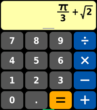

<!-- Generated by scripts/update_app_directory.py: do not edit by hand -->
[← All Pebble Developers](../developers.md)

# Yitz

*1 app · Last updated 2026-11-09 · [About these lists](../about-app-lists.md)*

Links: [Pebble App Store](https://apps.repebble.com/apps/dev/yitz_05e201936b813bdc225e4349) · [GitHub (Yitz42)](https://github.com/Yitz42)

<h2 class="app-name" id="app-18ed13485bda4a179779a531"><a href="https://apps.repebble.com/18ed13485bda4a179779a531">TinySci</a> v1.1.0</h2>
<a class="app-source" href="https://github.com/Yitz42/tinycalc" title="Source code" data-search-exclude>View source</a>

App

MIT Released 2026-11-03 Updated 2026-11-03

Runs on: Time 2

TinySci is a scientific calculator built for the Pebble Time 2 touch screen. MATH THAT LOOKS LIKE MATH What you type shows as real math as you go: fractions stack, powers rise, and the square…

