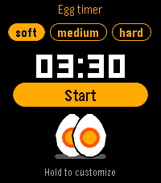

<!-- Generated by scripts/update_app_directory.py: do not edit by hand -->
[← All Pebble Developers](../developers.md)

# yoada

*2 apps · Last updated 2026-10-11 · [About these lists](../about-app-lists.md)*

Links: [Pebble App Store](https://apps.repebble.com/apps/dev/yoada_40295452a8505728bae5a632) · [GitLab (piconcely)](https://gitlab.com/piconcely) · [GitHub (yoann54)](https://github.com/yoann54)

<button type="button" data-filter="all" aria-pressed="true">All 2</button><button type="button" data-filter="watchface" aria-pressed="false" disabled>Watchfaces 0</button><button type="button" data-filter="watchapp" aria-pressed="false">Apps 2</button>

<label class="dev-sort">Sort by <select><option value="updated">Recently updated</option><option value="released">Newest release</option><option value="title">A–Z</option></select></label>

<h2 class="app-name" id="app-7fbac412862949529e130fc9"><a href="https://apps.repebble.com/7fbac412862949529e130fc9">Egg Timer</a> v1.1.3</h2>
<a class="app-source" href="https://gitlab.com/piconcely/egg-timer" title="Source code" data-search-exclude>View source</a>

App

Released 2026-10-01 Updated 2026-10-03

Runs on: Round 2, Time 2, Pebble 2 Duo, Pebble 2, Time Round, Time

Get the perfect breakfast egg - soft, medium or hard - right from your wrist. - Pick soft, medium or hard with Up/Down, press Select to start, pause or resume. - Hold Select to adjust a cooking…

<h2 class="app-name" id="app-a86a293b637a4a13923d4cc0"><a href="https://apps.repebble.com/a86a293b637a4a13923d4cc0">Backtrack</a> v1.1.1</h2>
<a class="app-source" href="https://github.com/yoann54/Backtrack" title="Source code" data-search-exclude>View source</a>

App

Released 2026-06-05 Updated 2026-09-30

Runs on: Round 2, Time 2, Pebble 2 Duo, Pebble 2, Time Round, Time

Find your way back to a saved point. Drop a pin at your location and Backtrack shows a compass-oriented arrow and the distance back to it, and buzzes when you arrive. Great for finding your car…

