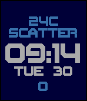

<!-- Generated by scripts/update_app_directory.py: do not edit by hand -->
[← All Pebble Developers](../developers.md)

# yoosee

*3 watchfaces · Last updated 2026-10-12 · [About these lists](../about-app-lists.md)*

Links: [Pebble App Store](https://apps.repebble.com/apps/dev/yoosee_56fc1d81085b3d583f000043) · [Rebble App Store](https://apps.rebble.io/en_US/developer/56fc1d81085b3d583f000043/1) · [GitHub (yoosee)](https://github.com/yoosee)

<button type="button" data-filter="all" aria-pressed="true">All 3</button><button type="button" data-filter="watchface" aria-pressed="false">Watchfaces 3</button><button type="button" data-filter="watchapp" aria-pressed="false" disabled>Apps 0</button>

<label class="dev-sort">Sort by <select><option value="updated">Recently updated</option><option value="released">Newest release</option><option value="title">A–Z</option></select></label>

<h2 class="app-name" id="app-57c5d5795e3c3db485000516"><a href="https://apps.repebble.com/57c5d5795e3c3db485000516">Zirconia</a> v1.2</h2>
<a class="app-source" href="https://github.com/yoosee/PebbleZirconiaWatch" title="Source code" data-search-exclude>View source</a>

Watchface

Released 2016-08-30 Updated 2018-02-09

Runs on: Round 2, Time 2, Pebble 2 Duo, Pebble 2, Time Round, Time

Digital Watchface with Time, Date, Current temperature, Weather condition and Health Steps, Bluetooth disconnect indicator. All colors are configurable. Your Pebble has to be updated to v4.0…

<h2 class="app-name" id="app-574456d819ef0ca0a300000d"><a href="https://apps.repebble.com/574456d819ef0ca0a300000d">Obsidian</a> v1.5</h2>
<a class="app-source" href="https://github.com/yoosee/PebbleWatchObsidian/" title="Source code" data-search-exclude>View source</a>

Watchface

Released 2016-05-24 Updated 2018-02-09

Runs on: Round 2, Time 2, Pebble 2 Duo, Pebble 2, Time Round, Time

Analog Clock watchface with Date, Weather and Health Steps, Bluetooth indicator. All Color configurable. Because of Weather provider inaccuracy, now it uses Weather.gov as a default provider, then…

<h2 class="app-name" id="app-57c7304cf69d1da5a6000635"><a href="https://apps.rebble.io/en_US/application/57c7304cf69d1da5a6000635">Timemeter</a> v1.1</h2>
<a class="app-source" href="https://github.com/yoosee/PebbleTimemeterWatch" title="Source code" data-search-exclude>View source</a>

Watchface

Released 2016-08-31 Updated 2017-08-28 Rebble App Store

Runs on: Round 2, Time 2, Time Round, Time

24 hours and 12 month clock.

