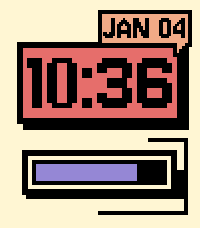
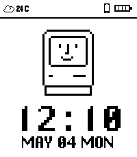
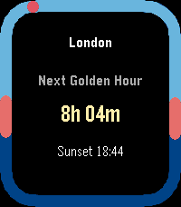
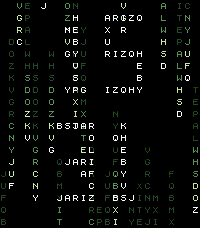
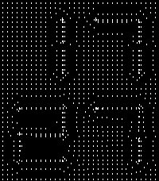
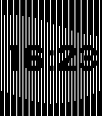

<!-- Generated by scripts/update_app_directory.py: do not edit by hand -->
[← All Pebble Developers](../developers.md)

# Yorks0n

*5 watchfaces and 1 app · Last updated 2026-10-11 · [About these lists](../about-app-lists.md)*

Links: [Pebble App Store](https://apps.repebble.com/apps/dev/yorks0n_692a907686176a0009926c79) · [GitHub (Yorks0n)](https://github.com/Yorks0n) · [Website (blog.yorks0n.com)](https://blog.yorks0n.com/)

<button type="button" data-filter="all" aria-pressed="true">All 6</button><button type="button" data-filter="watchface" aria-pressed="false">Watchfaces 5</button><button type="button" data-filter="watchapp" aria-pressed="false">Apps 1</button>

<label class="dev-sort">Sort by <select><option value="updated">Recently updated</option><option value="released">Newest release</option><option value="title">A–Z</option></select></label>

<h2 class="app-name" id="app-6959d36624ba4b0008d50149"><a href="https://apps.repebble.com/6959d36624ba4b0008d50149">Neubrutalism</a> v1.2.0</h2>
<a class="app-source" href="https://github.com/Yorks0n/neubrutalism" title="Source code" data-search-exclude>View source</a>

Watchface

MIT Released 2026-01-04 Updated 2026-08-03

Runs on: Time 2, Pebble 2 Duo, Pebble 2, Time, Classic

A watchface inspired by neubrutalism design aesthetic.

<h2 class="app-name" id="app-6967772efe3ac20009ace348"><a href="https://apps.repebble.com/6967772efe3ac20009ace348">HappyMac</a> v1.3.0</h2>
<a class="app-source" href="https://github.com/Yorks0n/HappyMac" title="Source code" data-search-exclude>View source</a>

Watchface · <a href="https://forum.rebble.io/t/491" title="Discuss this app on the Rebble forum" data-search-exclude>Forum thread</a>

No licence Released 2026-01-14 Updated 2026-05-04

Runs on: Round 2, Time 2, Pebble 2 Duo, Pebble 2, Time Round, Time, Classic

A watchface inspired by Happy Mac on Macintosh. Available in Light, Dark, and Color themes. Wish you happy :)

<h2 class="app-name" id="app-a32e0cb46c41426b8cd06df7"><a href="https://apps.repebble.com/a32e0cb46c41426b8cd06df7">Apollo</a> v1.1</h2>
<a class="app-source" href="https://github.com/Yorks0n/Apollo" title="Source code" data-search-exclude>View source</a>

App

No licence Released 2026-04-13 Updated 2026-04-24

Runs on: Round 2, Time 2, Pebble 2 Duo, Pebble 2, Time Round, Time, Classic

Apollo — Sun Tracking on Your Wrist Apollo lets you save multiple locations from the phone settings page and sync them to your Pebble, so you can check sunrise and sunset times for each place…

<h2 class="app-name" id="app-6979c159323ecb00092c53f9"><a href="https://apps.repebble.com/6979c159323ecb00092c53f9">Matrix01</a> v1.0</h2>
<a class="app-source" href="https://github.com/Yorks0n/pebble-watchface-Matrix01" title="Source code" data-search-exclude>View source</a>

Watchface · <a href="https://forum.rebble.io/t/583" title="Discuss this app on the Rebble forum" data-search-exclude>Forum thread</a>

No licence Released 2026-01-28 Updated 2026-01-28

Runs on: Round 2, Time 2, Pebble 2 Duo, Pebble 2, Time Round, Time

A digital rain effect watchface inspired by the movie &quot;The Matrix&quot;. It rains when time changes or shaken.

<h2 class="app-name" id="app-696f4db7e87ee700097955f6"><a href="https://apps.repebble.com/696f4db7e87ee700097955f6">Gravity</a> v1.1</h2>
<a class="app-source" href="https://github.com/Yorks0n/pebble-watchface-Gravity" title="Source code" data-search-exclude>View source</a>

Watchface · <a href="https://forum.rebble.io/t/536" title="Discuss this app on the Rebble forum" data-search-exclude>Forum thread</a>

No licence Released 2026-01-20 Updated 2026-01-20

Runs on: Round 2, Time 2, Pebble 2 Duo, Pebble 2, Time Round, Time, Classic

A watchface composed of a dot matrix network and the forces of attraction.

<h2 class="app-name" id="app-6968b1fe0bd3670009877828"><a href="https://apps.repebble.com/6968b1fe0bd3670009877828">Flow</a> v1.1</h2>
<a class="app-source" href="https://github.com/Yorks0n/pebble-watchface-flow" title="Source code" data-search-exclude>View source</a>

Watchface · <a href="https://forum.rebble.io/t/497" title="Discuss this app on the Rebble forum" data-search-exclude>Forum thread</a>

No licence Released 2026-01-15 Updated 2026-01-16

Runs on: Round 2, Time 2, Pebble 2 Duo, Pebble 2, Time Round, Time, Classic

Let&#x27;s flow with pebble. With various themes available.

