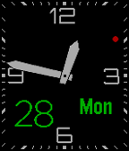

<!-- Generated by scripts/update_app_directory.py: do not edit by hand -->
[← All Pebble Developers](../developers.md)

# yoshimov

*1 watchface · Last updated 2026-10-12 · [About these lists](../about-app-lists.md)*

Links: [Pebble App Store](https://apps.repebble.com/apps/dev/yoshimov_5566c4b53b08fe49dd000022) · [GitHub (yoshimov)](https://github.com/yoshimov)

<h2 class="app-name" id="app-5608b975364a06eba9000022"><a href="https://apps.repebble.com/5608b975364a06eba9000022">Analog BigDate</a> v1.8</h2>
<a class="app-source" href="https://github.com/yoshimov/pebble-bigdate" title="Source code" data-search-exclude>View source</a>

Watchface

Released 2015-09-28 Updated 2015-11-14

Runs on: Round 2, Time 2, Pebble 2 Duo, Pebble 2, Time Round, Time, Classic

Simple analog watch face with big date. The date and week texts will move to avoid overlapping with hands. The following items are customizable. - Second hand style (none/ball/line) - Second hand…

