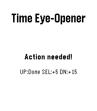

<!-- Generated by scripts/update_app_directory.py: do not edit by hand -->
[← All Pebble Developers](../developers.md)

# YoubieDr

*1 app · Last updated 2026-10-12 · [About these lists](../about-app-lists.md)*

Links: [Pebble App Store](https://apps.repebble.com/apps/dev/youbiedr_b4a93a2503c9366f08dccdf9) · [GitHub (AUBee19)](https://github.com/AUBee19)

<h2 class="app-name" id="app-6c04120d1cd1470594cfa29e"><a href="https://apps.repebble.com/6c04120d1cd1470594cfa29e">Time Eye-Opener</a> v1.1</h2>
<a class="app-source" href="https://github.com/AUBee19/Time-Eye-Opener/tree/main" title="Source code" data-search-exclude>View source</a>

App

No licence Released 2026-04-14 Updated 2026-04-18

Runs on: Time 2, Pebble 2 Duo

Time Eye-Opener: The notification that doesn&#x27;t take &quot;no&quot; for an answer. You’re in a meeting and a crucial text comes in. You can’t reply right now, but if you swipe it away, you know you’ll forget…

