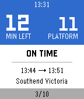

<!-- Generated by scripts/update_app_directory.py: do not edit by hand -->
[← All Pebble Developers](../developers.md)

# yoziru-desu

*1 app · Last updated 2026-10-12 · [About these lists](../about-app-lists.md)*

Links: [Pebble App Store](https://apps.repebble.com/apps/dev/yoziru-desu_560fd7a8ba529bd5f4000094) · [GitHub (yoziru-desu)](https://github.com/yoziru-desu) · [Website (paypal.me)](http://paypal.me/yoziru)

<h2 class="app-name" id="app-5738e66eeae0b2ef05000024"><a href="https://apps.repebble.com/5738e66eeae0b2ef05000024">Locomo</a> v2.1</h2>
<a class="app-source" href="https://github.com/yoziru-desu/locomo-pebble" title="Source code" data-search-exclude>View source</a>

App

Released 2016-05-15 Updated 2025-11-25

Runs on: Round 2, Time 2, Pebble 2 Duo, Pebble 2, Time Round, Time, Classic

Start Locomo when going to work or returning home and stop worrying about which train is next and which platform you need to go to. Locomo will show you how much time you have left, if your train…

