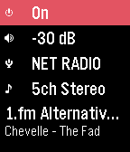
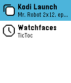
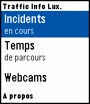

<!-- Generated by scripts/update_app_directory.py: do not edit by hand -->
[← All Pebble Developers](../developers.md)

# YS

*3 apps · Last updated 2026-10-12 · [About these lists](../about-app-lists.md)*

Links: [Pebble App Store](https://apps.repebble.com/apps/dev/ys_55787e740ad90da1d6000069) · [GitHub (ghys)](https://github.com/ghys)

<button type="button" data-filter="all" aria-pressed="true">All 3</button><button type="button" data-filter="watchface" aria-pressed="false" disabled>Watchfaces 0</button><button type="button" data-filter="watchapp" aria-pressed="false">Apps 3</button>

<label class="dev-sort">Sort by <select><option value="updated">Recently updated</option><option value="released">Newest release</option><option value="title">A–Z</option></select></label>

<h2 class="app-name" id="app-568888f73f3554bc53000056"><a href="https://apps.repebble.com/568888f73f3554bc53000056">Yamaha AV Remote</a> v2.0</h2>
<a class="app-source" href="https://github.com/ghys/pebble-yamaha-remote" title="Source code" data-search-exclude>View source</a>

App · <a href="https://forum.rebble.io/t/773" title="Discuss this app on the Rebble forum" data-search-exclude>Forum thread</a>

MIT Released 2016-01-03 Updated 2026-03-16

Runs on: Round 2, Time 2, Pebble 2 Duo, Pebble 2, Time Round, Time, Classic

A simple control watchapp for the basic functions of your network-enabled Yamaha AV receiver. Never look for the remote again! Tested on a RX-V479 but should work on all models compatible with the…

<h2 class="app-name" id="app-57e837473095e38a8900036c"><a href="https://apps.repebble.com/57e837473095e38a8900036c">Kodi Launch</a> v2</h2>
<a class="app-source" href="https://github.com/ghys/pebble-kodi-launch" title="Source code" data-search-exclude>View source</a>

App · <a href="https://forum.rebble.io/t/781" title="Discuss this app on the Rebble forum" data-search-exclude>Forum thread</a>

MIT Released 2016-09-25 Updated 2026-03-16

Runs on: Round 2, Time 2, Pebble 2 Duo, Pebble 2, Time Round, Time

The most complete controller and library browser for Kodi! (This watchapp is unofficial and not endorsed or supported by Team Kodi or the XBMC Foundation. Kodi and the Kodi logo are trademarks of…

<h2 class="app-name" id="app-55bc364028d738687f000001"><a href="https://apps.repebble.com/55bc364028d738687f000001">Traffic Info Luxembourg</a> v1.01</h2>
<a class="app-source" href="https://github.com/ghys/PebbleTrafficLux" title="Source code" data-search-exclude>View source</a>

App

No licence Released 2015-08-01 Updated 2015-09-25

Runs on: Time 2, Pebble 2 Duo, Pebble 2, Time, Classic

Traffic information for Luxembourg motorways on your wrist! Data is fetched from http://cita.lu. This app is unofficial and NOT in any way supported or endorsed by the Administration des ponts et…

