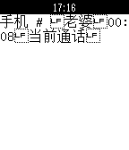

<!-- Generated by scripts/update_app_directory.py: do not edit by hand -->
[← All Pebble Developers](../developers.md)

# yunshansimon

*1 app · Last updated 2026-10-12 · [About these lists](../about-app-lists.md)*

Links: [Pebble App Store](https://apps.repebble.com/apps/dev/yunshansimon_5308b25d8d051a27b5000381) · [GitHub (yunshansimon)](https://github.com/yunshansimon) · [Website (pan.baidu.com)](http://pan.baidu.com/s/1i3HWmW1)

<h2 class="app-name" id="app-533227ae326898b7df000025"><a href="https://apps.repebble.com/533227ae326898b7df000025">Wachatpebble</a> v1.0.0</h2>
<a class="app-source" href="https://github.com/yunshansimon/pebble-notifier-international.git" title="Source code" data-search-exclude>View source</a>

App

Released 2014-03-26 Updated 2014-03-26

Runs on: Time 2, Pebble 2 Duo, Pebble 2, Time, Classic

This pebble-app is rewritten by Yang Tsao according to the source code by Tiago R. Espinha , compatible with pebble2.0. Because of using same UUID, you can continue using…

