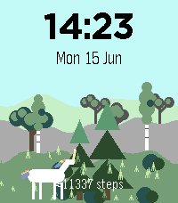

<!-- Generated by scripts/update_app_directory.py: do not edit by hand -->
[← All Pebble Developers](../developers.md)

# Øyvind Kvangardsnes

*1 watchface · Last updated 2026-10-12 · [About these lists](../about-app-lists.md)*

Links: [Pebble App Store](https://apps.repebble.com/apps/dev/yvind-kvangardsnes_9c8b7e90c261a8055961c2ef) · [GitHub (kvangaball)](https://github.com/kvangaball)

<h2 class="app-name" id="app-99ff53f1e5474a2686e66ac7"><a href="https://apps.repebble.com/99ff53f1e5474a2686e66ac7">Step Forest</a> v0.3.3</h2>
<a class="app-source" href="https://github.com/kvangaball/aforestofsteps" title="Source code" data-search-exclude>View source</a>

Watchface

Released 2026-06-01 Updated 2026-06-16

Runs on: Round 2, Time 2

A landscape with trees where you get more trees based on your step count

