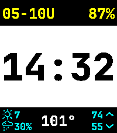

<!-- Generated by scripts/update_app_directory.py: do not edit by hand -->
[← All Pebble Developers](../developers.md)

# Zac West

*1 watchface · Last updated 2026-10-11 · [About these lists](../about-app-lists.md)*

Links: [Pebble App Store](https://apps.repebble.com/apps/dev/zac-west_0ab393df5c2cc212f1c9c320) · [GitHub (zacwest)](https://github.com/zacwest)

<h2 class="app-name" id="app-ffe77f70fb6e44fe80c90cb6"><a href="https://apps.repebble.com/ffe77f70fb6e44fe80c90cb6">Postcard</a> v0.1.0</h2>
<a class="app-source" href="https://github.com/zacwest/postcard-watchface" title="Source code" data-search-exclude>View source</a>

Watchface

Released 2026-05-12 Updated 2026-05-12

Runs on: Time 2, Pebble 2 Duo

Three bands of date, a big time, and configurable complications. --- - Weather by Open-Mateo https://open-meteo.com - JetBrains Mono ExtraBold (OFL 1.1): https://www.jetbrains.com/lp/mono/ …

