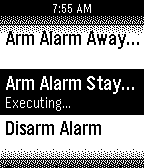

<!-- Generated by scripts/update_app_directory.py: do not edit by hand -->
[← All Pebble Developers](../developers.md)

# Zach Benz

*1 app · Last updated 2026-10-11 · [About these lists](../about-app-lists.md)*

Links: [Pebble App Store](https://apps.repebble.com/apps/dev/zach-benz_52f04fb9af0eabd0d500123e) · [GitHub (ZachBenz)](https://github.com/ZachBenz)

<h2 class="app-name" id="app-52f1d0b8e21be4b820000eb6"><a href="https://apps.repebble.com/52f1d0b8e21be4b820000eb6">Indigo Remote</a> v1.1</h2>
<a class="app-source" href="https://github.com/ZachBenz/IndigoRemote" title="Source code" data-search-exclude>View source</a>

App

Other Released 2014-02-05 Updated 2014-02-15

Runs on: Time 2, Pebble 2 Duo, Pebble 2, Time, Classic

A remote control for Perceptive Automation&#x27;s excellent Indigo home automation server for Mac OS X. New in Version 1.1: More robust configuration, faster loading Please note: Perceptive Automation…

