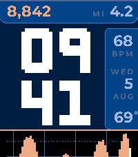
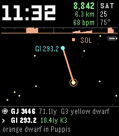
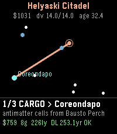
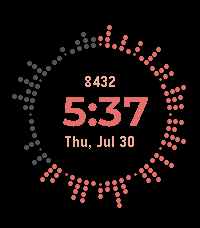

<!-- Generated by scripts/update_app_directory.py: do not edit by hand -->
[← All Pebble Developers](../developers.md)

# Zach Burnham

*7 watchfaces and 3 apps · Last updated 2026-10-11 · [About these lists](../about-app-lists.md)*

Links: [Pebble App Store](https://apps.repebble.com/apps/dev/zach-burnham_939ce698485e86de8b11f7ae) · [GitHub (thejambi)](https://github.com/thejambi) · [Website (burnsoftware.wordpress.com)](https://burnsoftware.wordpress.com/)

<button type="button" data-filter="all" aria-pressed="true">All 10</button><button type="button" data-filter="watchface" aria-pressed="false">Watchfaces 7</button><button type="button" data-filter="watchapp" aria-pressed="false">Apps 3</button>

<label class="dev-sort">Sort by <select><option value="updated">Recently updated</option><option value="released">Newest release</option><option value="title">A–Z</option></select></label>

<h2 class="app-name" id="app-401e8eb5432341dcb8ea111d"><a href="https://apps.repebble.com/401e8eb5432341dcb8ea111d">Emberline</a> v1.4.3</h2>
<a class="app-source" href="https://github.com/thejambi/Sparkline_Faces" title="Source code" data-search-exclude>View source</a>

Watchface

Released 2026-07-30 Updated 2026-08-22

Runs on: Time 2, Pebble 2 Duo, Pebble 2, Time

Your hour drawn as landscape - and last night&#x27;s sleep, before you get up. The bottom of the screen is the last sixty minutes: one column a minute, standing on the very bottom edge, with a…

<h2 class="app-name" id="app-3022b32401cd44e2a59e05a0"><a href="https://apps.repebble.com/3022b32401cd44e2a59e05a0">BrewSession</a> v1.2.0</h2>
<a class="app-source" href="https://github.com/thejambi/BrewSession-Pebble" title="Source code" data-search-exclude>View source</a>

App

Released 2026-08-07 Updated 2026-08-19

Runs on: Round 2, Time 2, Pebble 2 Duo, Pebble 2, Time Round, Time

A tea timer that knows which infusion you&#x27;re on. Set a custom steep time as fast as the stock timer - no tea database, no menu asking which infusion this is. Hit Start and pour during the felt…

<h2 class="app-name" id="app-a4d14d8c1e7140e79a4f588d"><a href="https://apps.repebble.com/a4d14d8c1e7140e79a4f588d">Solfarer Atlas</a> v1.2.0</h2>
<a class="app-source" href="https://github.com/thejambi/Solfarer-Atlas-Pebble" title="Source code" data-search-exclude>View source</a>

App

Released 2026-07-30 Updated 2026-08-11

Runs on: Round 2, Time 2, Pebble 2 Duo, Pebble 2, Time Round, Time

Travel where you like. Solfarer Atlas is the Local Bubble as a place you can walk around: 2,236 real star systems within 100 light-years of Sol - Proxima Centauri, Barnard&#x27;s Star, Wolf 359…

<h2 class="app-name" id="app-0f939bb26a844658a731280c"><a href="https://apps.repebble.com/0f939bb26a844658a731280c">Solfarer</a> v1.1.1</h2>
<a class="app-source" href="https://github.com/thejambi/Solfarer-Watchface" title="Source code" data-search-exclude>View source</a>

Watchface

Released 2026-07-25 Updated 2026-08-11

Runs on: Round 2, Time 2, Pebble 2 Duo, Pebble 2, Time Round, Time

Wander the real stars. Every morning your ship starts at Sol, and every hour it hops to a nearby star - real ones, from the Hipparcos catalog: Proxima Centauri, Barnard&#x27;s Star, Wolf 359, Tureis…

<h2 class="app-name" id="app-9420a2e218e54ce986c7c871"><a href="https://apps.repebble.com/9420a2e218e54ce986c7c871">Lighthaul</a> v1.2.2</h2>
<a class="app-source" href="https://github.com/thejambi/Lighthaul-Pebble" title="Source code" data-search-exclude>View source</a>

App

Released 2026-07-21 Updated 2026-08-01

Runs on: Round 2, Time 2, Pebble 2 Duo, Pebble 2, Time Round, Time

Haul cargo and passengers between the stars at a hair under lightspeed - and let special relativity be the economy. Deadlines run on universe time. You and your passengers age on ship time. The…

<h2 class="app-name" id="app-a5874b2f337249e58d31353d"><a href="https://apps.repebble.com/a5874b2f337249e58d31353d">Lighthaul Watchface</a> v1.4.0</h2>
<a class="app-source" href="https://github.com/thejambi/Lighthaul-Watchface" title="Source code" data-search-exclude>View source</a>

Watchface

Released 2026-07-22 Updated 2026-07-29

Runs on: Round 2, Time 2, Pebble 2 Duo, Pebble 2, Time Round, Time

The Lighthaul star map as a watchface - and your ship flies itself. Every day a new procedurally-generated cluster arrives, seeded by the date: every pilot wearing this face flies the same galaxy…

<h2 class="app-name" id="app-932411b4b5ba45ce839ff833"><a href="https://apps.repebble.com/932411b4b5ba45ce839ff833">ActiveHour2</a> v2.2.1</h2>
<a class="app-source" href="https://github.com/thejambi/ActiveHour" title="Source code" data-search-exclude>View source</a>

Watchface

Released 2026-07-20 Updated 2026-07-23

Runs on: Round 2, Time 2, Pebble 2 Duo, Pebble 2, Time Round, Time

This watchface uses Pebble Health data to show the time along with a visual display of how active you are every minute of the hour. It is inspired by a Fitbit watchface. Includes the following…

<h2 class="app-name" id="app-f6413c1d19c442cc8e6d5602"><a href="https://apps.repebble.com/f6413c1d19c442cc8e6d5602">Trekv3 TimeSteel</a> v5.2.0</h2>
<a class="app-source" href="https://github.com/thejambi/trekv3-timesteel" title="Source code" data-search-exclude>View source</a>

Watchface

Released 2026-07-21 Updated 2026-07-21

Runs on: Round 2, Time 2, Pebble 2 Duo, Pebble 2, Time Round, Time, Classic

An LCARS-style watchface with a large clock, day-of-week strip, date, week number, battery meter and step count. Highly configurable: multiple colour themes, invert, 12/24h, seconds or AM/PM, week…

<h2 class="app-name" id="app-56b6bb3c0b97730da600002e"><a href="https://apps.repebble.com/56b6bb3c0b97730da600002e">Active Hour</a> v1.20</h2>
<a class="app-source" href="https://github.com/thejambi/ActiveHour" title="Source code" data-search-exclude>View source</a>

Watchface

Released 2016-02-07 Updated 2016-10-14

Runs on: Round 2, Time 2, Pebble 2 Duo, Pebble 2, Time Round, Time

This watchface uses Pebble Health data to show the time along with a visual display of how active you are every minute of the hour. It is inspired by a Fitbit watchface. Includes the following…

<h2 class="app-name" id="app-55ad922da8f41e37f5000029"><a href="https://apps.repebble.com/55ad922da8f41e37f5000029">Thin-Red Hour</a> v0.4</h2>
<a class="app-source" href="https://burnsoftware.wordpress.com/" title="Source code" data-search-exclude>View source</a>

Watchface

Released 2015-07-21 Updated 2016-02-06

Runs on: Round 2, Time 2, Pebble 2 Duo, Pebble 2, Time Round, Time, Classic

I modified the Thin watchface by Chris Lewis and wanted to share my take on it. The biggest changes are the more circular shape of the watchface, the red hour hand, and the minute marks showing…

