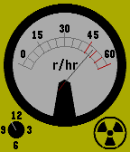

<!-- Generated by scripts/update_app_directory.py: do not edit by hand -->
[← All Pebble Developers](../developers.md)

# Zahkc

*1 watchface · Last updated 2026-10-12 · [About these lists](../about-app-lists.md)*

Links: [Rebble App Store](https://apps.rebble.io/en_US/developer/646445e64edef20009447d93/1) · [GitHub (Zahkc)](https://github.com/Zahkc)

<h2 class="app-name" id="app-64cfa8c1118fcc04241465cc"><a href="https://apps.rebble.io/en_US/application/64cfa8c1118fcc04241465cc">Geiger Counter</a> v1.0</h2>
<a class="app-source" href="https://github.com/Zahkc/Geiger-Watchface" title="Source code" data-search-exclude>View source</a>

Watchface

No licence Released 2023-08-06 Updated 2023-08-06 Rebble App Store

Runs on: Time 2, Pebble 2 Duo, Pebble 2, Time

A watch face stylized like a Analogue Geiger Counter. Built for pebble time.

