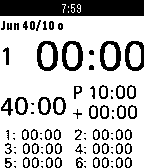

<!-- Generated by scripts/update_app_directory.py: do not edit by hand -->
[← All Pebble Developers](../developers.md)

# Zauberertz

*1 app · Last updated 2026-10-12 · [About these lists](../about-app-lists.md)*

Links: [Pebble App Store](https://apps.repebble.com/apps/dev/zauberertz_52f00b8a4ae363b8e300007d) · [GitHub (zaubererty)](https://github.com/zaubererty) · [Website (ziegler.bz)](http://ziegler.bz/)

<h2 class="app-name" id="app-53f45811d1a7a93dff00014e"><a href="https://apps.repebble.com/53f45811d1a7a93dff00014e">RefWatch</a> v1.2</h2>
<a class="app-source" href="https://github.com/zaubererty/RefWatch" title="Source code" data-search-exclude>View source</a>

App

Released 2014-08-20 Updated 2015-03-15

Runs on: Time 2, Pebble 2 Duo, Pebble 2, Time, Classic

This is a soccer referee watch app with pre defined profiles for swiss football Up Button: * Long - Start / Pause * Long while game running - Time penalty * Short after break - Shift period (1.2)…

