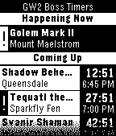

<!-- Generated by scripts/update_app_directory.py: do not edit by hand -->
[← All Pebble Developers](../developers.md)

# ZDBioHazard

*1 app · Last updated 2026-10-12 · [About these lists](../about-app-lists.md)*

Links: [Pebble App Store](https://apps.repebble.com/apps/dev/zdbiohazard_530e3c2dc3208aea0a000163) · [GitHub (ZDBioHazard)](https://github.com/ZDBioHazard) · [Website (forum-en.guildwars2.com)](https://forum-en.guildwars2.com/forum/community/links/World-Boss-Timer-Pebble-Watchapp)

<h2 class="app-name" id="app-5361b1a97ca4c8ba5e00003e"><a href="https://apps.repebble.com/5361b1a97ca4c8ba5e00003e">GW2 Boss Timers</a> v1.3</h2>
<a class="app-source" href="https://github.com/ZDBioHazard/pebble-gw2bosses" title="Source code" data-search-exclude>View source</a>

App

No licence Released 2014-05-01 Updated 2014-07-09

Runs on: Time 2, Pebble 2 Duo, Pebble 2, Time, Classic

This app displays a simple list of timers for the next several world boss events in Guild Wars 2. No Internet connection required. Uses the schedule information from the June 17, 2014 game update…

