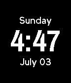
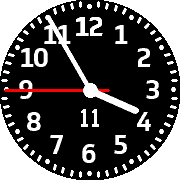
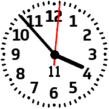
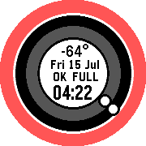
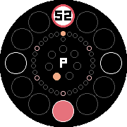
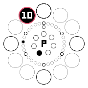

<!-- Generated by scripts/update_app_directory.py: do not edit by hand -->
[← All Pebble Developers](../developers.md)

# Zealotree

*8 watchfaces · Last updated 2026-10-12 · [About these lists](../about-app-lists.md)*

Links: [Pebble App Store](https://apps.repebble.com/apps/dev/zealotree_5722b3d1db5a405aa4000023) · [GitHub (zealotree)](https://github.com/zealotree)

<button type="button" data-filter="all" aria-pressed="true">All 8</button><button type="button" data-filter="watchface" aria-pressed="false">Watchfaces 8</button><button type="button" data-filter="watchapp" aria-pressed="false" disabled>Apps 0</button>

<label class="dev-sort">Sort by <select><option value="updated">Recently updated</option><option value="released">Newest release</option><option value="title">A–Z</option></select></label>

<h2 class="app-name" id="app-579181dd84242800800002e1"><a href="https://apps.repebble.com/579181dd84242800800002e1">Perpetual</a> v2.1</h2>
<a class="app-source" href="https://github.com/zealotree/Perpetual" title="Source code" data-search-exclude>View source</a>

Watchface

Released 2016-07-22 Updated 2016-10-08

Runs on: Round 2, Time 2, Time Round, Time

Perpetual is a watchface that displays the time, date, month and the weekday in an analogue fashion. The hour hand is red, and the minute hand is white. The 6 markers are ten minute markers. In…

<h2 class="app-name" id="app-5723f75bf697457b4600001f"><a href="https://apps.repebble.com/5723f75bf697457b4600001f">SleepyTime</a> v1.9</h2>
<a class="app-source" href="https://github.com/zealotree/Sleepy-Time" title="Source code" data-search-exclude>View source</a>

Watchface

Released 2016-04-30 Updated 2016-09-04

Runs on: Round 2, Time 2, Pebble 2 Duo, Pebble 2, Time Round, Time, Classic

Inspired by Nightface. Only show the time when you need it. Shake to view the current time and date, otherwise the watch sleeps (saving battery).

<h2 class="app-name" id="app-57acad61f01b53ce0c000154"><a href="https://apps.repebble.com/57acad61f01b53ce0c000154">LowViz Dark</a> v1.1</h2>
<a class="app-source" href="https://github.com/zealotree/LowViz/tree/dark" title="Source code" data-search-exclude>View source</a>

Watchface

Released 2016-08-11 Updated 2016-08-11

Runs on: Round 2, Time Round

LowViz Dark is an analogue watchface that emphasises readability for low vision users. It displays the Date (Day of Month), Time (Hours, Minutes, Seconds). It vibrates when disconnected from…

<h2 class="app-name" id="app-57aca152bb85ed22da0001bf"><a href="https://apps.repebble.com/57aca152bb85ed22da0001bf">LowViz</a> v1.2</h2>
<a class="app-source" href="https://github.com/zealotree/LowViz" title="Source code" data-search-exclude>View source</a>

Watchface

Released 2016-08-11 Updated 2016-08-11

Runs on: Round 2, Time Round

LowViz is an analogue watchface that emphasises readability for low vision users. It displays the Date (Day of Month), Time (Hours, Minutes, Seconds). It vibrates when disconnected from Bluetooth…

<h2 class="app-name" id="app-5789066184accc2867000032"><a href="https://apps.repebble.com/5789066184accc2867000032">ZFACECLOCK</a> v1.3</h2>
<a class="app-source" href="https://github.com/zealotree/ZFACECLOCK" title="Source code" data-search-exclude>View source</a>

Watchface

Released 2016-07-15 Updated 2016-07-15

Runs on: Round 2, Time Round

Inspired by AOFACECLOCK1st by Akemori Oda The same design with the following additions: - New Colours every time the watchface is launched and every time the Day changes (was every minute) - Added…

<h2 class="app-name" id="app-5781649266202ad3f7000531"><a href="https://apps.repebble.com/5781649266202ad3f7000531">Cirkular Helios</a> v1.3</h2>
<a class="app-source" href="https://github.com/zealotree/Cirkular/tree/helios" title="Source code" data-search-exclude>View source</a>

Watchface

Released 2016-07-09 Updated 2016-07-11

Runs on: Round 2, Time Round

-- TIME ROUND EXCLUSIVE -- It&#x27;s Cirkular with Sunrise/Sunset indicators and in dark mode. An analogue clock that displays the time and date based on the positions of the clock. Telling the time is…

<h2 class="app-name" id="app-577f0ff166202ae1d300035c"><a href="https://apps.repebble.com/577f0ff166202ae1d300035c">Cirkular</a> v1.2</h2>
<a class="app-source" href="https://github.com/zealotree/Cirkular" title="Source code" data-search-exclude>View source</a>

Watchface

Released 2016-07-08 Updated 2016-07-09

Runs on: Round 2, Time Round

-- TIME ROUND EXCLUSIVE -- An analogue clock that displays the time and date based on the positions of the clock. Telling the time is as simple as looking at the outer ring Outer Ring (12 circles)…

<h2 class="app-name" id="app-5779c4cd6c2104d5f80007f3"><a href="https://apps.repebble.com/5779c4cd6c2104d5f80007f3">Z Sleep</a> v1.05</h2>
<a class="app-source" href="https://github.com/zealotree/Sleepy-Time/tree/z-sleep" title="Source code" data-search-exclude>View source</a>

Watchface

Released 2016-07-04 Updated 2016-07-05

Runs on: Round 2, Time Round

Z Sleep Even the most zealous people need rest. So does your pebble. It preserves the battery life by only displaying and updating the time when the pebble is flicked. Features: - Shake to Update…

