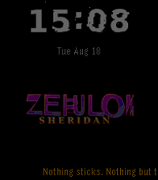

<!-- Generated by scripts/update_app_directory.py: do not edit by hand -->
[← All Pebble Developers](../developers.md)

# zebulon-sheridan

*1 watchface · Last updated 2026-10-12 · [About these lists](../about-app-lists.md)*

Links: [Rebble App Store](https://apps.rebble.io/en_US/developer/6a8469892167150008eaec24/1) · [GitHub (zebulon-sheridan)](https://github.com/zebulon-sheridan) · [Website (zebulonsheridan.com)](https://zebulonsheridan.com)

<h2 class="app-name" id="app-6a84702699fcd7000930016a"><a href="https://apps.rebble.io/en_US/application/6a84702699fcd7000930016a">Zebulon Sheridan</a> v1.1.0</h2>
<a class="app-source" href="https://github.com/zebulon-sheridan/zebulon-sheridan-watchface" title="Source code" data-search-exclude>View source</a>

Watchface · <a href="https://forum.rebble.io/t/1247" title="Discuss this app on the Rebble forum" data-search-exclude>Forum thread</a>

Released 2026-08-18 Updated 2026-08-18 Rebble App Store

Runs on: Round 2, Time 2, Pebble 2 Duo, Pebble 2, Time Round, Time, Classic

time is an illusion life but an echo

