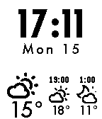
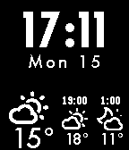

<!-- Generated by scripts/update_app_directory.py: do not edit by hand -->
[← All Pebble Developers](../developers.md)

# Zeduaz

*2 watchfaces · Last updated 2026-10-11 · [About these lists](../about-app-lists.md)*

Links: [Pebble App Store](https://apps.repebble.com/apps/dev/zeduaz_5481eab7bdba69dcaf000031) · [GitHub (Zeduaz)](https://github.com/Zeduaz) · [Website (wunderground.com)](http://www.wunderground.com/weather/api/)

<button type="button" data-filter="all" aria-pressed="true">All 2</button><button type="button" data-filter="watchface" aria-pressed="false">Watchfaces 2</button><button type="button" data-filter="watchapp" aria-pressed="false" disabled>Apps 0</button>

<label class="dev-sort">Sort by <select><option value="updated">Recently updated</option><option value="released">Newest release</option><option value="title">A–Z</option></select></label>

<h2 class="app-name" id="app-557dca65d8339ae151000059"><a href="https://apps.repebble.com/557dca65d8339ae151000059">Weather My Way edited by Zeduaz - INVERTED</a> v1.0</h2>
<a class="app-source" href="https://github.com/Zeduaz/weather-my-way" title="Source code" data-search-exclude>View source</a>

Watchface

No licence Released 2015-06-14 Updated 2015-06-14

Runs on: Time 2, Pebble 2 Duo, Pebble 2, Time, Classic

Another weather watchface with weather forecast. Edited watchface Weather My Way - INVERTED. Location services on your phone must be enabled and always on because location is automatically…

<h2 class="app-name" id="app-54a7c92de8b7f5f267000044"><a href="https://apps.repebble.com/54a7c92de8b7f5f267000044">Weather My Way edited by Zeduaz</a> v1.3</h2>
<a class="app-source" href="https://github.com/Zeduaz/weather-my-way" title="Source code" data-search-exclude>View source</a>

Watchface

No licence Released 2015-01-03 Updated 2015-06-14

Runs on: Time 2, Pebble 2 Duo, Pebble 2, Time, Classic

Another weather watchface with weather forecast. Edited watchface Weather My Way. Location services on your phone must be enabled and always on because location is automatically determined…

