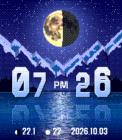
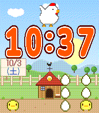
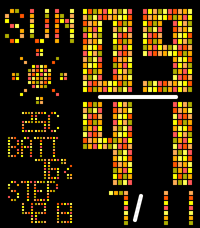

<!-- Generated by scripts/update_app_directory.py: do not edit by hand -->
[← All Pebble Developers](../developers.md)

# zefuru

*3 watchfaces and 1 app · Last updated 2026-10-12 · [About these lists](../about-app-lists.md)*

Links: [Pebble App Store](https://apps.repebble.com/apps/dev/zefuru_6190e1008e31f0a6d6aba7af) · [GitHub (fumi6625)](https://github.com/fumi6625)

<button type="button" data-filter="all" aria-pressed="true">All 4</button><button type="button" data-filter="watchface" aria-pressed="false">Watchfaces 3</button><button type="button" data-filter="watchapp" aria-pressed="false">Apps 1</button>

<label class="dev-sort">Sort by <select><option value="updated">Recently updated</option><option value="released">Newest release</option><option value="title">A–Z</option></select></label>

<h2 class="app-name" id="app-c00e658c460d44b4a11a94eb"><a href="https://apps.repebble.com/c00e658c460d44b4a11a94eb">Mountain Moon</a> v2.0.0</h2>
<a class="app-source" href="https://github.com/fumi6625/pebble-watch-face-moon-faces" title="Source code" data-search-exclude>View source</a>

Watchface

No licence Released 2026-06-24 Updated 2026-10-03

Runs on: Time 2

Mountain Moon A landscape watch face. Features ・Automatic day/night switching — Detects sunrise and sunset times. Transitions from sunrise → daytime → sunset → moonlit night ・Moon phase display —…

<h2 class="app-name" id="app-68ba72cacce54bfc836b749a"><a href="https://apps.repebble.com/68ba72cacce54bfc836b749a">MORE-RECOMO</a> v2.0.0</h2>
<a class="app-source" href="https://github.com/fumi6625/RECOMO-JAVA" title="Source code" data-search-exclude>View source</a>

App

No licence Released 2026-06-24 Updated 2026-10-03

Runs on: Time 2

MORE RECOMO This is an enhanced version of the original RECOMO app. It’s a voice memo and notification app. Jot down, save, and set reminders for thoughts that pop into your head. The app enters…

<h2 class="app-name" id="app-6a87e21fbddf479bb8c14db9"><a href="https://apps.repebble.com/6a87e21fbddf479bb8c14db9">HIYOKO</a> v2.0.0</h2>
<a class="app-source" href="https://github.com/fumi6625/pebble-face-HIYOKO" title="Source code" data-search-exclude>View source</a>

Watchface

No licence Released 2026-08-02 Updated 2026-10-03

Runs on: Time 2

This is a cute chick watch face that I designed with my daughter. It&#x27;s so cute.

<h2 class="app-name" id="app-b08b5aae67e44880a3685e3d"><a href="https://apps.repebble.com/b08b5aae67e44880a3685e3d">Dot Face Weather</a> v1.1.1</h2>
<a class="app-source" href="https://github.com/fumi6625/dotface-Orange" title="Source code" data-search-exclude>View source</a>

Watchface

No licence Released 2026-07-11 Updated 2026-08-02

Runs on: Time 2

Dot Face Weather When you launch the app, dots flow in from the left. We’ve released a major update. Just give your wrist a light shake, and the layout will slide to display the weather forecast…

