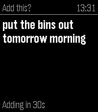
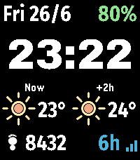

<!-- Generated by scripts/update_app_directory.py: do not edit by hand -->
[← All Pebble Developers](../developers.md)

# zeroesandones

*1 watchface and 3 apps · Last updated 2026-10-11 · [About these lists](../about-app-lists.md)*

Links: [Pebble App Store](https://apps.repebble.com/apps/dev/zeroesandones_2e6cca3d47b90f5b14f075bb) · [GitHub (benjaminjgill)](https://github.com/benjaminjgill)

<button type="button" data-filter="all" aria-pressed="true">All 4</button><button type="button" data-filter="watchface" aria-pressed="false">Watchfaces 1</button><button type="button" data-filter="watchapp" aria-pressed="false">Apps 3</button>

<label class="dev-sort">Sort by <select><option value="updated">Recently updated</option><option value="released">Newest release</option><option value="title">A–Z</option></select></label>

<h2 class="app-name" id="app-d274e5b6487946bf915b7810"><a href="https://apps.repebble.com/d274e5b6487946bf915b7810">WristList (Index 01 for your watch!)</a> v1.0.1</h2>
<a class="app-source" href="https://github.com/benjaminjgill/WristList" title="Source code" data-search-exclude>View source</a>

App

No licence Released 2026-09-07 Updated 2026-10-04

Runs on: Time 2

Pebble Index for your watch. This app allows you to dictate a message on your watch and publish the dictation to a CalDav server (Nextcloud/Ownecloud etc.) as a Task. Just add the CalDav address…

<h2 class="app-name" id="app-6fa7606d637c4b4daabcb6a9"><a href="https://apps.repebble.com/6fa7606d637c4b4daabcb6a9">BigWeather</a> v2.2.5</h2>
<a class="app-source" href="https://github.com/benjaminjgill/BigWeather" title="Source code" data-search-exclude>View source</a>

App

No licence Released 2026-06-24 Updated 2026-10-04

Runs on: Round 2, Time 2, Pebble 2 Duo, Pebble 2, Time Round, Time

My eyesight isn&#x27;t as great as it used to be when I bought the first Pebble watch many moons ago (pesky ageing.......) Anyway it seems like all the weather apps are trying to cram loads of…

<h2 class="app-name" id="app-f248e316f6ff404da0731fce"><a href="https://apps.repebble.com/f248e316f6ff404da0731fce">BigFace</a> v2.3.4</h2>
<a class="app-source" href="https://github.com/benjaminjgill/BigFace" title="Source code" data-search-exclude>View source</a>

Watchface

No licence Released 2026-06-26 Updated 2026-10-04

Runs on: Time 2

Big Face is a simple clean big bold watch face that&#x27;s readable at a glance for those who don&#x27;t want to squint at their watch to know what time it is oh....its free with no paywall! Version 2 added…

<h2 class="app-name" id="app-c1f17d76aabe41fd9d1060dc"><a href="https://apps.repebble.com/c1f17d76aabe41fd9d1060dc">UK Rail</a> v1.23.1</h2>
<a class="app-source" href="https://github.com/benjaminjgill/UKRail" title="Source code" data-search-exclude>View source</a>

App

No licence Released 2026-06-14 Updated 2026-09-19

Runs on: Round 2, Time 2, Pebble 2 Duo, Pebble 2, Time Round, Time

**New Version - This now works with no requirement to sign up for a National Rail Data account key, you can use the default UK Rail data source provided in settings to retrieve National Rail Data…

