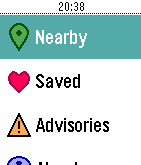

<!-- Generated by scripts/update_app_directory.py: do not edit by hand -->
[← All Pebble Developers](../developers.md)

# ZeroUptime

*1 app · Last updated 2026-10-11 · [About these lists](../about-app-lists.md)*

Links: [Pebble App Store](https://apps.repebble.com/apps/dev/zerouptime_52bc8a80530bf4c5bd000170) · [GitHub (aelindeman)](https://github.com/aelindeman) · [Website (ael.me)](http://ael.me/wwy)

<h2 class="app-name" id="app-5404f8e0ec33d19e2200008b"><a href="https://apps.repebble.com/5404f8e0ec33d19e2200008b">WMATA With You</a> v2.5</h2>
<a class="app-source" href="https://github.com/aelindeman/wmata-with-you" title="Source code" data-search-exclude>View source</a>

App

MIT Released 2014-09-01 Updated 2017-01-13

Runs on: Round 2, Time 2, Pebble 2 Duo, Pebble 2, Time Round, Time, Classic

Washington, D.C. Metrobus &amp; Metrorail schedules on your wrist! View incoming buses and trains for stations and stops near your location, and check network advisories so you&#x27;re not stuck waiting…

