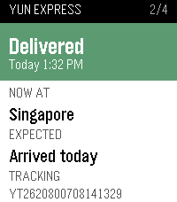
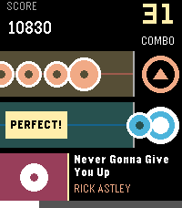
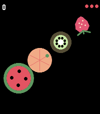
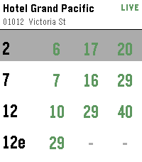
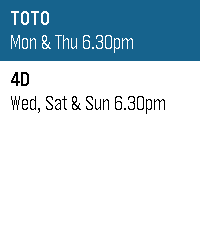

<!-- Generated by scripts/update_app_directory.py: do not edit by hand -->
[← All Pebble Developers](../developers.md)

# Zhang Qichuan

*1 watchface and 5 apps · Last updated 2026-10-12 · [About these lists](../about-app-lists.md)*

Links: [Pebble App Store](https://apps.repebble.com/apps/dev/zhang-qichuan_53043485117485c22f0000cf) · [GitHub (qichuan)](https://github.com/qichuan) · [Website (zhangqichuan.com)](https://zhangqichuan.com/)

<button type="button" data-filter="all" aria-pressed="true">All 6</button><button type="button" data-filter="watchface" aria-pressed="false">Watchfaces 1</button><button type="button" data-filter="watchapp" aria-pressed="false">Apps 5</button>

<label class="dev-sort">Sort by <select><option value="updated">Recently updated</option><option value="released">Newest release</option><option value="title">A–Z</option></select></label>

<h2 class="app-name" id="app-b29dcf9df26f41888a420a31"><a href="https://apps.repebble.com/b29dcf9df26f41888a420a31">Parcel Tracking</a> v1.1</h2>
<a class="app-source" href="https://github.com/qichuan/pebble-parcel-tracking" title="Source code" data-search-exclude>View source</a>

App

Released 2026-08-07 Updated 2026-09-22

Runs on: Round 2, Time 2, Pebble 2 Duo, Pebble 2, Time Round, Time, Classic

Wondering if any parcel is arriving today? This app answers that question in an instant. Open any shipment to check its current status, location, estimated delivery time, and complete past…

<h2 class="app-name" id="app-68b7d031bd624a9ebaeb9102"><a href="https://apps.repebble.com/68b7d031bd624a9ebaeb9102">Rockbeat</a> v1.4</h2>
<a class="app-source" href="https://github.com/qichuan/pebble-rockbeat" title="Source code" data-search-exclude>View source</a>

App

Released 2026-07-31 Updated 2026-09-06

Runs on: Time 2, Pebble 2 Duo

A simple rhythm game. Just hit the UP or SELECT button to the melody! Right now you can play the following songs: Never Gonna Give You Up — Rick Astley You Are Not Alone — M. Jackson Golden —…

<h2 class="app-name" id="app-82fc69b2d0964fe28e2520c3"><a href="https://apps.repebble.com/82fc69b2d0964fe28e2520c3">Fruit Chop</a> v1.3.0</h2>
<a class="app-source" href="https://github.com/qichuan/pebble-fruit-chop" title="Source code" data-search-exclude>View source</a>

App

Released 2026-07-27 Updated 2026-08-08

Runs on: Round 2, Time 2

Swipe across the screen to slice the fruit — just watch out for the bombs. That&#x27;s all it takes to play Fruit Chop, a fast, fun fruit-slicing game built right for your wrist. This game needs a…

<h2 class="app-name" id="app-7c8d451e7cf148988d11cd11"><a href="https://apps.repebble.com/7c8d451e7cf148988d11cd11">Majulah SG</a> v1.1.0</h2>
<a class="app-source" href="https://github.com/qichuan/pebble-watchface-singapore" title="Source code" data-search-exclude>View source</a>

Watchface

Released 2026-07-29 Updated 2026-08-02

Runs on: Round 2, Time 2, Pebble 2 Duo, Pebble 2, Time Round, Time, Classic

Majulah Singapura! The Singapore flag on your wrist. Works on every Pebble — round or square, colour or black-and-white. Install it and celebrate 9 August together!

<h2 class="app-name" id="app-7f8d2c5153c8436abdada1eb"><a href="https://apps.repebble.com/7f8d2c5153c8436abdada1eb">SG Bus</a> v1.0.1</h2>
<a class="app-source" href="https://github.com/qichuan/pebble-sg-bus" title="Source code" data-search-exclude>View source</a>

App

Released 2026-07-24 Updated 2026-07-26

Runs on: Round 2, Time 2, Pebble 2 Duo, Pebble 2, Time Round, Time, Classic

Singapore bus arrival times on your wrist. Find bus stops near you using your phone&#x27;s location, or open a favourite stop to see live arrival times. Tap a bus service for the next few buses…

<h2 class="app-name" id="app-427683454738466d9aff642a"><a href="https://apps.repebble.com/427683454738466d9aff642a">SG Toto &amp; 4D</a> v1.0.0</h2>
<a class="app-source" href="https://github.com/qichuan/pebble-sg-toto-4d" title="Source code" data-search-exclude>View source</a>

App

Released 2026-07-05 Updated 2026-07-05

Runs on: Round 2, Time 2, Pebble 2 Duo, Pebble 2, Time Round, Time, Classic

Huat ah! 🎉 Feeling lucky? SG Toto &amp; 4D puts the latest Singapore Pools results right on your wrist. Results are updated shortly after every draw — TOTO on Monday &amp; Thursday, 4D on Wednesday…

