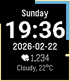

<!-- Generated by scripts/update_app_directory.py: do not edit by hand -->
[← All Pebble Developers](../developers.md)

# Zipher

*1 watchface · Last updated 2026-10-11 · [About these lists](../about-app-lists.md)*

Links: [Pebble App Store](https://apps.repebble.com/apps/dev/zipher_5f78873e17c3f000c7858898) · [GitHub (Zipher04)](https://github.com/Zipher04)

<h2 class="app-name" id="app-6999ade2f387ef000995cae5"><a href="https://apps.repebble.com/6999ade2f387ef000995cae5">Simple Watch Face</a> v1.2</h2>
<a class="app-source" href="https://github.com/Zipher04/SimpleWatchFace" title="Source code" data-search-exclude>View source</a>

Watchface · <a href="https://forum.rebble.io/t/695" title="Discuss this app on the Rebble forum" data-search-exclude>Forum thread</a>

No licence Released 2026-02-21 Updated 2026-02-25

Runs on: Time 2, Time

A simpe watch face modified from the default Kickstart watchface came with pebble time. The added inforinformation are: 1. ISO date. 2. Weekday 3. Step 4. Current weather data from OpenWeatherMap…

