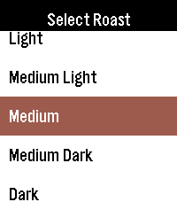
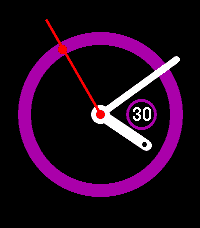

<!-- Generated by scripts/update_app_directory.py: do not edit by hand -->
[← All Pebble Developers](../developers.md)

# zman441

*1 watchface and 1 app · Last updated 2026-10-12 · [About these lists](../about-app-lists.md)*

Links: [Pebble App Store](https://apps.repebble.com/apps/dev/zman441_552186344c872d0a9000005e) · [GitHub (zackdolsen)](https://github.com/zackdolsen)

<button type="button" data-filter="all" aria-pressed="true">All 2</button><button type="button" data-filter="watchface" aria-pressed="false">Watchfaces 1</button><button type="button" data-filter="watchapp" aria-pressed="false">Apps 1</button>

<label class="dev-sort">Sort by <select><option value="updated">Recently updated</option><option value="released">Newest release</option><option value="title">A–Z</option></select></label>

<h2 class="app-name" id="app-a216163b4af54f9f8b834fdb"><a href="https://apps.repebble.com/a216163b4af54f9f8b834fdb">French Press Buddy</a> v2.1</h2>
<a class="app-source" href="https://github.com/zackdolsen/FrenchPressBuddy" title="Source code" data-search-exclude>View source</a>

App · <a href="https://forum.rebble.io/t/922" title="Discuss this app on the Rebble forum" data-search-exclude>Forum thread</a>

Released 2026-04-17 Updated 2026-08-03

Runs on: Round 2, Time 2, Pebble 2 Duo, Pebble 2, Time Round, Time, Classic

French Press Buddy is a simple, easy to use app to help you create the best French press coffee you can in 3 easy steps! Features: - Support for 5 different roasts of coffee - Calculates how much…

<h2 class="app-name" id="app-56da59a9b8a67d825e00004f"><a href="https://apps.repebble.com/56da59a9b8a67d825e00004f">Color Circle</a> v3.0.0</h2>
<a class="app-source" href="https://github.com/zackdolsen/ColorCircle" title="Source code" data-search-exclude>View source</a>

Watchface · <a href="https://forum.rebble.io/t/1112" title="Discuss this app on the Rebble forum" data-search-exclude>Forum thread</a>

Released 2016-03-05 Updated 2026-07-02

Runs on: Round 2, Time 2, Pebble 2 Duo, Pebble 2, Time Round, Time, Classic

Color Circle is a clean, expressive analog watch face with smooth animations and plenty of customization to make it your own. Features: - Animated startup where the watch face grows and swings…

