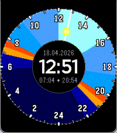

<!-- Generated by scripts/update_app_directory.py: do not edit by hand -->
[← All Pebble Developers](../developers.md)

# Zoe Pfister

*1 watchface · Last updated 2026-10-11 · [About these lists](../about-app-lists.md)*

Links: [Pebble App Store](https://apps.repebble.com/apps/dev/zoe-pfister_b170dded8f8b2f8e38632e5f) · [GitHub (zoepfister)](https://github.com/zoepfister)

<h2 class="app-name" id="app-42cab49dbb4d4b26bb981ecb"><a href="https://apps.repebble.com/42cab49dbb4d4b26bb981ecb">Sunset</a> v1.0.1</h2>
<a class="app-source" href="https://github.com/zoepfister/pebble-sunset" title="Source code" data-search-exclude>View source</a>

Watchface

Released 2026-04-18 Updated 2026-04-18

Runs on: Round 2, Time 2, Pebble 2 Duo, Time Round, Time

A 24h watchface showing sunset and sunrise.

