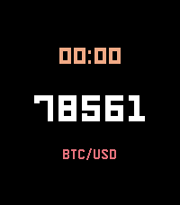

<!-- Generated by scripts/update_app_directory.py: do not edit by hand -->
[← All Pebble Developers](../developers.md)

# zoonooz

*1 watchface · Last updated 2026-10-11 · [About these lists](../about-app-lists.md)*

Links: [Pebble App Store](https://apps.repebble.com/apps/dev/zoonooz_969f88a79fa2a315c051f402) · [GitHub (zoonooz)](https://github.com/zoonooz)

<h2 class="app-name" id="app-1e6d477d5ce4430099b24089"><a href="https://apps.repebble.com/1e6d477d5ce4430099b24089">BitcoinWatch2</a> v2.0.1</h2>
<a class="app-source" href="https://github.com/zoonooz/BitcoinWatch" title="Source code" data-search-exclude>View source</a>

Watchface

Released 2026-08-31 Updated 2026-08-31

Runs on: Round 2, Time 2, Pebble 2 Duo, Pebble 2, Time Round, Time, Classic

If you think Bitcoin or crypto price matters more than the time, this watch face is built for you. Features: - 📈 Live price, refreshed every minute from the exchange - 🔄 Choose Binance or Coinbase…

