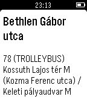

<!-- Generated by scripts/update_app_directory.py: do not edit by hand -->
[← All Pebble Developers](../developers.md)

# Zsolt Váradi

*1 app · Last updated 2026-10-12 · [About these lists](../about-app-lists.md)*

Links: [Pebble App Store](https://apps.repebble.com/apps/dev/zsolt-v-radi_540df624949c0447f600002f) · [GitHub (vzsg)](https://github.com/vzsg)

<h2 class="app-name" id="app-555b99ac45377abb4a00001c"><a href="https://apps.repebble.com/555b99ac45377abb4a00001c">PebFUTÁR</a> v1.4</h2>
<a class="app-source" href="https://github.com/vzsg/bkk-futar-pebble" title="Source code" data-search-exclude>View source</a>

App

Released 2015-05-19 Updated 2017-04-09

Runs on: Time 2, Pebble 2 Duo, Pebble 2, Time, Classic

Támogatott nyelvek: magyar és angol a telefon nyelve alapján. Supported languages: Hungarian and English, set according to the phone language. A PebFUTÁR alkalmazással nyomon követheted a BKK…

