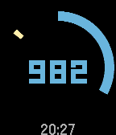

<!-- Generated by scripts/update_app_directory.py: do not edit by hand -->
[← All Pebble Developers](../developers.md)

# zszen

*3 watchfaces · Last updated 2026-10-12 · [About these lists](../about-app-lists.md)*

Links: [Pebble App Store](https://apps.repebble.com/apps/dev/zszen_57586deacbd52b0d51000004) · [GitHub (zszen)](https://github.com/zszen) · [GitHub (pebble-examples)](https://github.com/pebble-examples) · [Website (twitter.com)](http://twitter.com/zszen)

<button type="button" data-filter="all" aria-pressed="true">All 3</button><button type="button" data-filter="watchface" aria-pressed="false">Watchfaces 3</button><button type="button" data-filter="watchapp" aria-pressed="false" disabled>Apps 0</button>

<label class="dev-sort">Sort by <select><option value="updated">Recently updated</option><option value="released">Newest release</option><option value="title">A–Z</option></select></label>

<h2 class="app-name" id="app-57586e4ccbd52b9732000001"><a href="https://apps.repebble.com/57586e4ccbd52b9732000001">ZWatch</a> v4.3</h2>
<a class="app-source" href="https://github.com/zszen/PebbleFace_ZSimpleTime" title="Source code" data-search-exclude>View source</a>

Watchface

Released 2016-06-08 Updated 2016-12-23

Runs on: Round 2, Time 2, Pebble 2 Duo, Pebble 2, Time Round, Time, Classic

simple clock display. this number is hour display only. battery save. first number position is hour in one day percentage. second number position is minute turn around. v3.8 add always highlight…

<h2 class="app-name" id="app-57cd6e04f69d1d636000026c"><a href="https://apps.repebble.com/57cd6e04f69d1d636000026c">ZSwissSquare</a> v1.3</h2>
<a class="app-source" href="https://github.com/zszen/pebble_zswisssquare" title="Source code" data-search-exclude>View source</a>

Watchface

Released 2016-09-05 Updated 2016-10-25

Runs on: Time 2, Pebble 2 Duo, Pebble 2, Time, Classic

This watchface base on &quot;SwissSquare&quot;. The author ask me for support the local setting function. So I deal it. It may lose some function like vibes.

<h2 class="app-name" id="app-5776a81d66202abc7f0000c7"><a href="https://apps.repebble.com/5776a81d66202abc7f0000c7">ZSteps</a> v1.3</h2>
<a class="app-source" href="https://github.com/pebble-examples/strider-watchface" title="Source code" data-search-exclude>View source</a>

Watchface

Released 2016-07-01 Updated 2016-07-04

Runs on: Round 2, Time 2, Pebble 2 Duo, Pebble 2, Time Round, Time, Classic

I modify by example app &quot;strider-watchface&quot; And change it to watchface.

