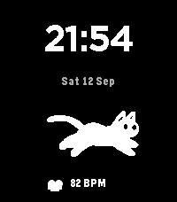

<!-- Generated by scripts/update_app_directory.py: do not edit by hand -->
[← All Pebble Developers](../developers.md)

# zunda

*1 watchface · Last updated 2026-10-12 · [About these lists](../about-app-lists.md)*

Links: [Pebble App Store](https://apps.repebble.com/apps/dev/zunda_669dbd4a49087f5ce51c5e89) · [GitHub (zunda-pixel)](https://github.com/zunda-pixel)

<h2 class="app-name" id="app-836a679deee247d19d4bd4e4"><a href="https://apps.repebble.com/836a679deee247d19d4bd4e4">RunCat for Pebble</a> v1.0.5</h2>
<a class="app-source" href="https://github.com/zunda-pixel/runcat-for-pebble" title="Source code" data-search-exclude>View source</a>

Watchface

Released 2026-09-12 Updated 2026-09-21

Runs on: Round 2, Time 2, Pebble 2 Duo, Pebble 2, Time Round, Time

RunCat for Pebble A playful watchface where the official RunCat runs faster as your heart rate rises. ## Features - Animated RunCat running in place - Animation speed changes with your heart rate…

