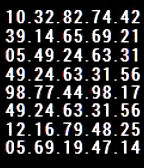

<!-- Generated by scripts/update_app_directory.py: do not edit by hand -->
[← All Pebble Developers](../developers.md)

# Zzzzzane

*1 watchface · Last updated 2026-10-12 · [About these lists](../about-app-lists.md)*

Links: [Pebble App Store](https://apps.repebble.com/apps/dev/zzzzzane_52f0171f8cbe654b5900010f) · [GitHub (zzzzzane)](https://github.com/zzzzzane)

<h2 class="app-name" id="app-5350acebb542511a780000f5"><a href="https://apps.repebble.com/5350acebb542511a780000f5">RandomNumbers</a> v2.0</h2>
<a class="app-source" href="https://github.com/zzzzzane/RandomNumbers" title="Source code" data-search-exclude>View source</a>

Watchface

Released 2014-04-18 Updated 2014-04-28

Runs on: Time 2, Pebble 2 Duo, Pebble 2, Time, Classic

Displays a screen of mostly random numbers with the Time and Date &quot;hidden&quot;--the uppermost left value is the hour, uppermost right is the minutes, lower left is the month, lower right is the day…

