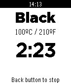
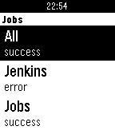
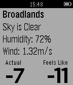

---
hide:
  - toc
---

<!-- Generated by scripts/update_app_directory.py: do not edit by hand -->
# Pebble Apps: J

[← All Pebble Apps](../watchapps.md) · [A](a.md) · [B](b.md) · [C](c.md) · [D](d.md) · [E](e.md) · [F](f.md) · [G](g.md) · [H](h.md) · [I](i.md) · **J** · [K](k.md) · [L](l.md) · [M](m.md) · [N](n.md) · [O](o.md) · [P](p.md) · [Q](q.md) · [R](r.md) · [S](s.md) · [T](t.md) · [U](u.md) · [V](v.md) · [W](w.md) · [X](x.md) · [Y](y.md) · [Z](z.md) · [0–9 & other](other.md)

*13 apps · Last updated 2026-10-11 · [About these lists](../about-app-lists.md)*

<h2 class="app-name" id="app-5421ac37c6da7aeb0000018b"><a href="https://apps.repebble.com/5421ac37c6da7aeb0000018b">J&#x27;s Tea Timer</a> v1.1</h2>
<a class="app-source" href="https://github.com/jarannilsen/PebbleTeaTime" title="Source code" data-search-exclude>View source</a>

by <a href="../developers/jaran-nilsen.html" title="More from this developer">Jaran Nilsen</a>

Released 2014-09-23 Updated 2014-10-15

Runs on: Time 2, Pebble 2 Duo, Pebble 2, Time, Classic

Tea timer for your Pebble. Select your type of tea and the application will tell you the best temperature for the water and how long you should let your tea steep. Version 1.1: - Custom steeping…

<h2 class="app-name" id="app-5529cf1a05b83a307900009e"><a href="https://apps.repebble.com/5529cf1a05b83a307900009e">Jab</a> v1.0</h2>
<a class="app-source" href="https://github.com/hongyuchen/jab" title="Source code" data-search-exclude>View source</a>

by <a href="../developers/hongyu-chen.html" title="More from this developer">Hongyu Chen</a>

Released 2015-04-12 Updated 2015-04-12

Runs on: Time 2, Pebble 2 Duo, Pebble 2, Time, Classic

Until now, measuring improvement and tracking performance for punch-based athletics were difficult tasks, measured only by the face of your opponents. Now with Jab, an app for the Pebble…

<h2 class="app-name" id="app-54527bf9d692a12cfa000081"><a href="https://apps.repebble.com/54527bf9d692a12cfa000081">JavaPay</a> v1.3</h2>
<a class="app-source" href="https://github.com/a2/javapay" title="Source code" data-search-exclude>View source</a>

by <a href="../developers/alex-akers.html" title="More from this developer">Alex Akers</a>

MIT Released 2014-10-30 Updated 2015-11-01

Runs on: Round 2, Time 2, Pebble 2 Duo, Pebble 2, Time Round, Time, Classic

JavaPay allows quick access to your Starbucks card. Just enter your card number on the watch and scan it at the till to pay. ——— Disclaimer: JavaPay is not affiliated with or maintained by…

<h2 class="app-name" id="app-56a49e1711d0acdd4700002a"><a href="https://apps.repebble.com/56a49e1711d0acdd4700002a">Jebble</a> v1.3</h2>
<a class="app-source" href="https://github.com/edouardkleinhans/jebble_watchapp" title="Source code" data-search-exclude>View source</a>

by <a href="../developers/edouard-kleinhans.html" title="More from this developer">Edouard Kleinhans</a>

Released 2016-01-24 Updated 2016-11-03

Runs on: Round 2, Time 2, Pebble 2 Duo, Pebble 2, Time Round, Time, Classic

Plugin pour permettre à votre montre Pebble de contrôler Jeedom (www.jeedom.fr)

<h2 class="app-name" id="app-558723ce4fa1ea5864000035"><a href="https://apps.repebble.com/558723ce4fa1ea5864000035">Jenkins Build Status</a> v1.1</h2>
<a class="app-source" href="https://github.com/FuriKuri/jenkins-build-status.git" title="Source code" data-search-exclude>View source</a>

by <a href="../developers/furikuri.html" title="More from this developer">FuriKuri</a>

No licence Released 2015-06-21 Updated 2015-06-21

Runs on: Time 2, Pebble 2 Duo, Pebble 2, Time, Classic

Simple app to get an overview of your Jenkins jobs.

<h2 class="app-name" id="app-5479daef572d57ad9100002b"><a href="https://apps.repebble.com/5479daef572d57ad9100002b">Jogger</a> v1.73</h2>
<a class="app-source" href="https://github.com/antonioasaro/Antonio-Jogger" title="Source code" data-search-exclude>View source</a>

by <a href="../developers/antonio-asaro.html" title="More from this developer">Antonio Asaro</a>

No licence Released 2014-11-29 Updated 2016-03-06

Runs on: Round 2, Time 2, Pebble 2 Duo, Pebble 2, Time Round, Time, Classic

Very very simple jogging aid. For 10+1 runs. Vibrates after 10mins (== walk break) and then one minute later (== resume running). Buttons: top=start, bottom=stop; middle (long press)=reset. Press…

<h2 class="app-name" id="app-52ff8e23432d1c7d2200012c"><a href="https://apps.repebble.com/52ff8e23432d1c7d2200012c">JP&#x27;Tris</a> v1.0.0</h2>
<a class="app-source" href="https://github.com/jpca/pebble-jptris" title="Source code" data-search-exclude>View source</a>

by <a href="../developers/jp-studio.html" title="More from this developer">JP&#x27;Studio</a>

Released 2014-02-15 Updated 2014-02-17

Runs on: Time 2, Pebble 2 Duo, Pebble 2, Time, Classic

This is a Tetris clone for pebble smart watch, with extra pieces if you exceed 300 points. Instructions : - up button : move left - down button : move right - middle button : rotate - have fun !!…

<h2 class="app-name" id="app-576619b60cc8f5552100016d"><a href="https://apps.repebble.com/576619b60cc8f5552100016d">JS Compatibility</a> v0.02</h2>
<a class="app-source" href="https://github.com/bhdouglass/pebble-js-compatibility" title="Source code" data-search-exclude>View source</a>

by <a href="../developers/brian-douglass.html" title="More from this developer">Brian Douglass</a>

No licence Released 2016-06-19 Updated 2016-06-22

Runs on: Round 2, Time 2, Pebble 2 Duo, Pebble 2, Time Round, Time, Classic

A Pebble watch app to test the compatibility of different JavaScript engines. This is being used to test RockWork&#x27;s compatibility with the official Pebble App&#x27;s JavaScript engine. RockWork is an…

<h2 class="app-name" id="app-54ebb991b0a2e249e20000e9"><a href="https://apps.repebble.com/54ebb991b0a2e249e20000e9">JsConf</a> v0.1</h2>
<a class="app-source" href="https://github.com/loverajoel/jsconf-pebble" title="Source code" data-search-exclude>View source</a>

by <a href="../developers/joel-lovera.html" title="More from this developer">Joel Lovera</a>

Released 2015-02-23 Updated 2015-02-23

Runs on: Time 2, Pebble 2 Duo, Pebble 2, Time, Classic

- Events - Talks - Info Beta version Open source project

<h2 class="app-name" id="app-5717ea24a86f0f5c67000008"><a href="https://apps.repebble.com/5717ea24a86f0f5c67000008">json_pull</a> v1.7</h2>
<a class="app-source" href="https://github.com/PHNTXX/first_pebble_app" title="Source code" data-search-exclude>View source</a>

by <a href="../developers/phntxx.html" title="More from this developer">phntxx</a>

No licence Released 2016-04-20 Updated 2016-08-26

Runs on: Round 2, Time 2, Pebble 2 Duo, Pebble 2, Time Round, Time, Classic

my first pebble app. basically just pulls information from json apis. credit goes to openweathermap, bitcoinaverage and theysaidso for the apis.

<h2 class="app-name" id="app-55cd00b3197194813b000045"><a href="https://apps.repebble.com/55cd00b3197194813b000045">JumpRopeCounter</a> v1.0</h2>
<a class="app-source" href="https://github.com/freddiefujiwara/JumpRopeCounter" title="Source code" data-search-exclude>View source</a>

by <a href="../developers/fumikazu-fujiwara.html" title="More from this developer">Fumikazu Fujiwara</a>

Released 2015-08-13 Updated 2015-08-13

Runs on: Time 2, Pebble 2 Duo, Pebble 2, Time, Classic

You can count your jump rope exercise now!

<h2 class="app-name" id="app-54db4d94d913346bc3000055"><a href="https://apps.repebble.com/54db4d94d913346bc3000055">Just Weather</a> v1.8</h2>
<a class="app-source" href="https://github.com/jtcgreyfox/PBWeather" title="Source code" data-search-exclude>View source</a>

by <a href="../developers/honourity.html" title="More from this developer">Honourity</a>

Released 2015-02-11 Updated 2016-09-01

Runs on: Time 2, Pebble 2 Duo, Pebble 2, Time, Classic

Gets current weather stats for current location. Update: Added choice of wind speed units in app config. Displays: Closest location weather data was retrieved from Description of weather Humidity…

<h2 class="app-name" id="app-672b1221aeef4d30897a361c"><a href="https://apps.repebble.com/672b1221aeef4d30897a361c">JW Daily Text</a> v2.8.0</h2>
<a class="app-source" href="https://github.com/testarossa47/jw-daily-text" title="Source code" data-search-exclude>View source</a>

by <a href="../developers/testarossa47.html" title="More from this developer">testarossa47</a>

Released 2026-07-20 Updated 2026-09-21

Runs on: Round 2, Time 2, Pebble 2 Duo, Pebble 2, Time Round, Time, Classic

Read today&#x27;s Bible text and commentary on your Pebble. Works offline, preselects your watch language, with color UI, smooth day animations and touch scrolling.

