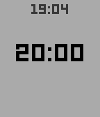
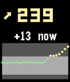

---
hide:
  - toc
---

<!-- Generated by scripts/update_app_directory.py: do not edit by hand -->
# Pebble Apps: X

[← All Pebble Apps](../watchapps.md) · [A](a.md) · [B](b.md) · [C](c.md) · [D](d.md) · [E](e.md) · [F](f.md) · [G](g.md) · [H](h.md) · [I](i.md) · [J](j.md) · [K](k.md) · [L](l.md) · [M](m.md) · [N](n.md) · [O](o.md) · [P](p.md) · [Q](q.md) · [R](r.md) · [S](s.md) · [T](t.md) · [U](u.md) · [V](v.md) · [W](w.md) · **X** · [Y](y.md) · [Z](z.md) · [0–9 & other](other.md)

*4 apps · Last updated 2026-10-11 · [About these lists](../about-app-lists.md)*

<h2 class="app-name" id="app-62cdbbd1f0886b0009c74042"><a href="https://apps.repebble.com/62cdbbd1f0886b0009c74042">XCTimer</a> v1.1</h2>
<a class="app-source" href="https://github.com/clay53/PebbleXCTimer" title="Source code" data-search-exclude>View source</a>

by <a href="../developers/clayton-does-things.html" title="More from this developer">Clayton Does Things</a>

Released 2022-07-12 Updated 2023-01-06

Runs on: Time 2, Pebble 2 Duo, Pebble 2, Time

A repeating timer and stopwatch for XC and track.

<h2 class="app-name" id="app-54adbee8647b4f548f339063"><a href="https://apps.repebble.com/54adbee8647b4f548f339063">xDrip CGM</a> v1.0.0</h2>
<a class="app-source" href="https://github.com/BigWebstas/PebbleXDrip" title="Source code" data-search-exclude>View source</a>

by <a href="../developers/webstas-webstas.html" title="More from this developer">Webstas “Webstas”</a>

No licence Released 2026-09-09 Updated 2026-09-09

Runs on: Round 2, Time 2, Pebble 2 Duo, Pebble 2, Time Round, Time

A Pebble quick-launch app that shows your xDrip+ CGM data — number, trend, delta and a 2-hour graph. It is not a watchface, so you can run any watchface and still get a glucose glance on demand…

<h2 class="app-name" id="app-52f0253c4ae3633a6400083a"><a href="https://apps.repebble.com/52f0253c4ae3633a6400083a">XKCD Comic</a> v2.2</h2>
<a class="app-source" href="https://github.com/mhungerford/png_xkcd" title="Source code" data-search-exclude>View source</a>

by <a href="../developers/matthew-hungerford.html" title="More from this developer">Matthew Hungerford</a>

Released 2014-02-03 Updated 2015-12-18

Runs on: Round 2, Time 2, Pebble 2 Duo, Pebble 2, Time Round, Time, Classic

Update: More comics, now resumes where you left off. XKCD is webcomic about sarcasm, math, technology, and science. XCDK is licensed under the Creative Commons (CC BY-NC 2.5). uPNG ported for &gt;70…

<h2 class="app-name" id="app-b626e39712aa46adb6d09fe1"><a href="https://apps.repebble.com/b626e39712aa46adb6d09fe1">XKCD Reader</a> v1.0.3</h2>
<a class="app-source" href="https://github.com/priyankark/xkcd-reader-pebble" title="Source code" data-search-exclude>View source</a>

by <a href="../developers/aircodum.html" title="More from this developer">AirCodum</a> · <a href="https://forum.rebble.io/t/892" title="Discuss this app on the Rebble forum" data-search-exclude>Forum thread</a>

Released 2026-04-17 Updated 2026-04-18

Runs on: Round 2, Time 2, Pebble 2 Duo, Pebble 2, Time Round, Time, Classic

Interactive XKCD comic reader. Controls: SELECT loads a random comic. UP/DOWN scrolls the comic manually. Long-press SELECT or shake the watch to reveal the alt-text caption. BACK exits.

