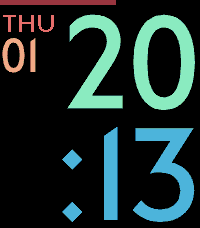
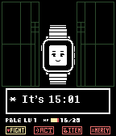
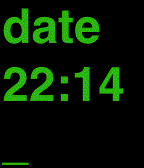
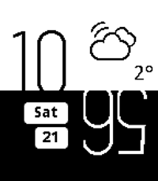
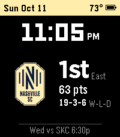

---
hide:
  - toc
---

<!-- Generated by scripts/update_app_directory.py: do not edit by hand -->
# Pebble Watchfaces: U

[← All Pebble Watchfaces](../watchfaces.md) · [A](a.md) · [B](b.md) · [C](c.md) · [D](d.md) · [E](e.md) · [F](f.md) · [G](g.md) · [H](h.md) · [I](i.md) · [J](j.md) · [K](k.md) · [L](l.md) · [M](m.md) · [N](n.md) · [O](o.md) · [P](p.md) · [Q](q.md) · [R](r.md) · [S](s.md) · [T](t.md) · **U** · [V](v.md) · [W](w.md) · [X](x.md) · [Y](y.md) · [Z](z.md) · [0–9 & other](other.md)

*25 watchfaces · Last updated 2026-10-11 · [About these lists](../about-app-lists.md)*

<h2 class="app-name" id="app-5344540189b0ae14d80003b9"><a href="https://apps.rebble.io/en_US/application/5344540189b0ae14d80003b9">UCONN Logo</a> v7.2</h2>
<a class="app-source" href="https://github.com/DHKaplan/UCONN/blob/master/UCONN-V7.2.zip" title="Source code" data-search-exclude>View source</a>

by <a href="../developers/wa1oui.html" title="More from this developer">WA1OUI</a>

No licence Released 2014-04-08 Updated 2016-10-18 Rebble App Store

Runs on: Round 2, Time 2, Pebble 2 Duo, Pebble 2, Time Round, Time, Classic

Here&#x27;s the UCONN Huskies&#x27; Logo. A Bluetooth indicator (and vibration when connectivity is lost) as well as battery percentage and a battery percentage bar (showing green for OK, Red for 20% or…

<h2 class="app-name" id="app-5351c69996ca68d67e000042"><a href="https://apps.repebble.com/5351c69996ca68d67e000042">Uhrzeit als Text by n3v3r</a> v3.1</h2>
<a class="app-source" href="https://github.com/n3v3r001/n3v3rstextone" title="Source code" data-search-exclude>View source</a>

by <a href="../developers/n3v3r.html" title="More from this developer">n3v3r</a>

Released 2014-04-19 Updated 2025-12-01

Runs on: Time 2, Pebble 2 Duo, Pebble 2, Time, Classic

n3v3rs text one: Dieses Watchface zeigt die Uhrzeit als Text (Deutsch) und ist konfigurierbar! Features: * Demnächst: Anzeige des Wochentags! * Datumsanzeige * Deutsch…

<h2 class="app-name" id="app-56856d6774e1dcc8f8000029"><a href="https://apps.repebble.com/56856d6774e1dcc8f8000029">UL</a> v1.0</h2>
<a class="app-source" href="https://github.com/ElliottAYoung/Pebble-UL" title="Source code" data-search-exclude>View source</a>

by <a href="../developers/elliottayoung.html" title="More from this developer">ElliottAYoung</a>

No licence Released 2015-12-31 Updated 2015-12-31

Runs on: Round 2, Time 2, Time Round, Time

A colorful analog watch face using the Underwriters Laboratories logo - complete with the date and remaining battery percentage.

<h2 class="app-name" id="app-58988a8c6d34e335f30001f4"><a href="https://apps.repebble.com/58988a8c6d34e335f30001f4">Ulm</a> v1.1</h2>
<a class="app-source" href="https://github.com/GreenHex/Pebble.Anery.Q" title="Source code" data-search-exclude>View source</a>

by <a href="../developers/the-resetter.html" title="More from this developer">The Resetter</a>

No licence Released 2017-02-06 Updated 2017-02-10

Runs on: Time 2, Pebble 2 Duo, Pebble 2, Time, Classic

Simple, elegant and easy-to-read watchface that consumes less power. This is a variation of Anery-SQ (which itself is based on the Notorious watchface).

<h2 class="app-name" id="app-5485a551075d4c0154000072"><a href="https://apps.repebble.com/5485a551075d4c0154000072">Ultimate Text Watch</a> v2.4</h2>
<a class="app-source" href="https://github.com/zecoj/ultimate.text.watch" title="Source code" data-search-exclude>View source</a>

by <a href="../developers/ben-nguyen.html" title="More from this developer">Ben Nguyen</a>

Released 2014-12-08 Updated 2016-01-09

Runs on: Time 2, Pebble 2 Duo, Pebble 2, Time, Classic

★New Name New Feature★Tell times in plain English in many ways★ Like it? Heart it! features: - tells time in plain English multiple ways: + fuzzy (ex. 12:44 = quarter to one) + human (ex. 12:44 =…

<h2 class="app-name" id="app-6abf59c037b3780009304810"><a href="https://apps.repebble.com/6abf59c037b3780009304810">Ultra</a> v1.8.0</h2>
<a class="app-source" href="https://github.com/eduardochiaro/ultra-watchface" title="Source code" data-search-exclude>View source</a>

by <a href="../developers/ec-apps.html" title="More from this developer">EC Apps</a> · <a href="https://forum.rebble.io/t/1398" title="Discuss this app on the Rebble forum" data-search-exclude>Forum thread</a>

Released 2026-10-02 Updated 2026-10-09

Runs on: Round 2, Time 2

An analog watchface for Pebble with eight complications you choose yourself. Four gauges curve around the corners, four subdials sit inside the dial, and every one is yours to swap. - Eight slots…

<h2 class="app-name" id="app-541584d8ef53049a2300005b"><a href="https://apps.repebble.com/541584d8ef53049a2300005b">Uncertainty Time</a> v1.0</h2>
<a class="app-source" href="https://github.com/CMun/UncertaintyTime" title="Source code" data-search-exclude>View source</a>

by <a href="../developers/c-munkelt.html" title="More from this developer">C. Munkelt</a>

MIT Released 2014-09-14 Updated 2014-09-28

Runs on: Time 2, Pebble 2 Duo, Pebble 2, Time, Classic

This watch face displays the time in a minimalistic, battery preserving fashion. The display gets refreshed only every eighth of an hour. The inner number shows the hour, the outer indicator the…

<h2 class="app-name" id="app-95bbad18b5df477a9b970702"><a href="https://apps.repebble.com/95bbad18b5df477a9b970702">underface</a> v1.1</h2>
<a class="app-source" href="https://github.com/EngineerRunner/underface" title="Source code" data-search-exclude>View source</a>

by <a href="../developers/engineerrunner.html" title="More from this developer">engineerrunner</a>

GPL-3.0 Released 2026-04-04 Updated 2026-04-04

Runs on: Round 2, Time 2

a watchface built with Alloy, inspired by undertale. features: - 7 soul colours, one for each day of the week - date and time - weather - battery (health bar)

<h2 class="app-name" id="app-67ce30a8d2acb303aedd4abe"><a href="https://apps.rebble.io/en_US/application/67ce30a8d2acb303aedd4abe">Underground</a> v7.5</h2>
<a class="app-source" href="https://github.com/astosia/Underground" title="Source code" data-search-exclude>View source</a>

by <a href="../developers/astosia.html" title="More from this developer">astosia</a> · <a href="https://forum.rebble.io/t/413" title="Discuss this app on the Rebble forum" data-search-exclude>Forum thread</a>

No licence Released 2025-03-10 Updated 2026-01-04 Rebble App Store

Runs on: Round 2, Time 2, Pebble 2 Duo, Pebble 2, Time Round, Time, Classic

Underground is a customizable, easy to read, large font watchface using the London Underground font. Now with optional weather! Shake or tap to show weather for 10 seconds. Weather uses…

<h2 class="app-name" id="app-564e744e86b141f0c300000f"><a href="https://apps.repebble.com/564e744e86b141f0c300000f">undertale</a> v3.0</h2>
<a class="app-source" href="https://github.com/rickr/undertale" title="Source code" data-search-exclude>View source</a>

by <a href="../developers/rickr.html" title="More from this developer">RickR</a>

Released 2015-11-20 Updated 2015-11-25

Runs on: Round 2, Time 2, Pebble 2 Duo, Pebble 2, Time Round, Time, Classic

Watchface created by Sako based on the hit RPG Undertale. Time is displayed in the dialog box. Battery remaining is displayed as HP.

<h2 class="app-name" id="app-31982194f0bb4f248a6a44fd"><a href="https://apps.repebble.com/31982194f0bb4f248a6a44fd">Undertale - Still You</a> v1.0.0</h2>
<a class="app-source" href="https://github.com/salim-benhamadi/Pebble-Undertale" title="Source code" data-search-exclude>View source</a>

by <a href="../developers/salim-benhamadi.html" title="More from this developer">Salim Benhamadi</a>

Released 2026-09-29 Updated 2026-09-29

Runs on: Round 2, Time 2, Pebble 2 Duo, Pebble 2, Time Round, Time, Classic

Undertale&#x27;s &quot;Despite everything, it&#x27;s still you.&quot; typed out in pixel letters, rewriting itself every minute.

<h2 class="app-name" id="app-562aa454948d06fc92000007"><a href="https://apps.repebble.com/562aa454948d06fc92000007">Undertale Watchface</a> v2.0</h2>
<a class="app-source" href="https://github.com/rileybrazell/UndertaleWatch" title="Source code" data-search-exclude>View source</a>

by <a href="../developers/riley-brazell.html" title="More from this developer">Riley Brazell</a>

Released 2015-10-23 Updated 2016-03-23

Runs on: Round 2, Time 2, Pebble 2 Duo, Pebble 2, Time Round, Time, Classic

Simple Undertale-themed watchface for Pebble Classic and Pebble Steel! Shows local time, date, and temperature in Fahrenheit! Tap/shake the watch to get a wink from your good buddy Sans!

<h2 class="app-name" id="app-565fdd4a0ea7f7eaa9000008"><a href="https://apps.repebble.com/565fdd4a0ea7f7eaa9000008">Undertime</a> v1.3</h2>
<a class="app-source" href="https://github.com/turnervink/undertime" title="Source code" data-search-exclude>View source</a>

by <a href="../developers/turner-vink.html" title="More from this developer">Turner Vink</a>

Released 2015-12-03 Updated 2017-01-07

Runs on: Time 2, Pebble 2 Duo, Pebble 2, Time, Classic

Checking the time... it fills you with DETERMINATION. A new Undertale character every hour or every time you launch the watchface. The health bar empties if your watch disconnects from your phone…

<h2 class="app-name" id="app-558cd08aa2deec5bc0000039"><a href="https://apps.repebble.com/558cd08aa2deec5bc0000039">Unix Conole Time</a> v1.0</h2>
<a class="app-source" href="https://github.com/JKCowboy/u-time" title="Source code" data-search-exclude>View source</a>

by <a href="../developers/javacowboy.html" title="More from this developer">JavaCowboy</a>

No licence Released 2015-06-26 Updated 2015-06-26

Runs on: Time 2, Pebble 2 Duo, Pebble 2, Time, Classic

UTime (u-time) is a Pebble watchface that displays time as if commands were typed from the unix console. Others have created similar watchfaces but this one adds a little more console realism…

<h2 class="app-name" id="app-5618284f1d9c8c20f900001b"><a href="https://apps.repebble.com/5618284f1d9c8c20f900001b">Unix style</a> v1.2</h2>
<a class="app-source" href="https://github.com/twodogwalker/PebbleFace_Ux" title="Source code" data-search-exclude>View source</a>

by <a href="../developers/frank-prins.html" title="More from this developer">Frank Prins</a>

Released 2015-10-09 Updated 2015-11-11

Runs on: Time 2, Pebble 2 Duo, Pebble 2, Time, Classic

A first playing around face, inspired by Unix interfacing. It is quite like the other you will find around here, named Terminal etc. Oh, and yes, I am aware the unix commands shown are not valid…

<h2 class="app-name" id="app-f5049ca6ebfd485aa8595b60"><a href="https://apps.repebble.com/f5049ca6ebfd485aa8595b60">Upcoming Calendar Cards</a> v1.4.0</h2>
<a class="app-source" href="https://github.com/sbrueckl/upcoming-calendar-cards" title="Source code" data-search-exclude>View source</a>

by <a href="../developers/sojocha.html" title="More from this developer">Sojocha</a>

Released 2026-04-17 Updated 2026-04-28

Runs on: Round 2, Time 2, Pebble 2 Duo, Pebble 2, Time Round, Time

The watchface shows digital time, the next upcoming Google Calendar event as a sliding card, live weather, date, battery, and Bluetooth status. This watchface was heavily inspired by Ester…

<h2 class="app-name" id="app-5564ab23421e8451aa00008a"><a href="https://apps.repebble.com/5564ab23421e8451aa00008a">Upright</a> v1.0</h2>
<a class="app-source" href="https://github.com/Jnmattern/Upright" title="Source code" data-search-exclude>View source</a>

by <a href="../developers/jnm.html" title="More from this developer">Jnm</a>

No licence Released 2015-05-26 Updated 2015-05-26

Runs on: Time 2, Pebble 2 Duo, Pebble 2, Time, Classic

Don&#x27;t bother with gravity anymore! The watch knows! Don&#x27;t bend your elbow to show the time, the time rotates to be always upright!

<h2 class="app-name" id="app-5634363f396cf4a5da00004c"><a href="https://apps.rebble.io/en_US/application/5634363f396cf4a5da00004c">UpsideDown</a> v2.7-rbl</h2>
<a class="app-source" href="https://edwinfinch.com/redirect/pebble-legacy-source" title="Source code" data-search-exclude>View source</a>

by <a href="../developers/edwin-finch.html" title="More from this developer">Edwin Finch</a>

Released 2015-10-31 Updated 2021-06-17 Rebble App Store

Runs on: Round 2, Time 2, Pebble 2 Duo, Pebble 2, Time Round, Time, Classic

An old classic from our original collection from 2014-2016, now free &amp; open source!

<h2 class="app-name" id="app-6a7686ad1772b200090ffb34"><a href="https://apps.rebble.io/en_US/application/6a7686ad1772b200090ffb34">UQM Pilot Watchface</a> v1.1.0</h2>
<a class="app-source" href="https://github.com/daktak/pebble_uqm_pilot_face" title="Source code" data-search-exclude>View source</a>

by <a href="../developers/daktak.html" title="More from this developer">Daktak</a> · <a href="https://forum.rebble.io/t/1218" title="Discuss this app on the Rebble forum" data-search-exclude>Forum thread</a>

Released 2026-08-08 Updated 2026-08-08 Rebble App Store

Runs on: Time 2, Pebble 2 Duo, Pebble 2, Time, Classic

Watchface showing pilots from the Ur Quan Masters along with the pilots name. Configurable

<h2 class="app-name" id="app-5b01f9eaf385887700000bc2"><a href="https://apps.rebble.io/en_US/application/5b01f9eaf385887700000bc2">UQM Watchface</a> v1.2.0</h2>
<a class="app-source" href="https://github.com/daktak/pebble_uqm_watchface" title="Source code" data-search-exclude>View source</a>

by <a href="../developers/daktak.html" title="More from this developer">Daktak</a> · <a href="https://forum.rebble.io/t/1044" title="Discuss this app on the Rebble forum" data-search-exclude>Forum thread</a>

Released 2018-05-20 Updated 2026-06-15 Rebble App Store

Runs on: Round 2, Time 2, Pebble 2 Duo, Pebble 2, Time Round, Time, Classic

Ships from The Ur-Quan Masters as second, minute or hour hand. http://sc2.sourceforge.net/

<h2 class="app-name" id="app-c8134a4e1ea84e7293abb0e6"><a href="https://apps.repebble.com/c8134a4e1ea84e7293abb0e6">UQM_Pilot_Face</a> v1.1</h2>
<a class="app-source" href="https://github.com/david-barrett/pebble_uqm_watchface" title="Source code" data-search-exclude>View source</a>

by <a href="../developers/dabar.html" title="More from this developer">dabar</a>

Released 2026-04-10 Updated 2026-04-10

Runs on: Round 2, Time 2, Pebble 2 Duo, Pebble 2, Time Round, Time, Classic

Watchface showing pilots from the Ur Quan Masters Pilot image changes every minute

<h2 class="app-name" id="app-6ca65e90a29d45c6bf7e20b6"><a href="https://apps.repebble.com/6ca65e90a29d45c6bf7e20b6">Urban Reserve</a> v1.1.0</h2>
<a class="app-source" href="https://github.com/Nicell/urban-reserve-pebble" title="Source code" data-search-exclude>View source</a>

by <a href="../developers/nick-winans.html" title="More from this developer">Nick Winans</a>

No licence Released 2026-07-09 Updated 2026-07-25

Runs on: Round 2

A Round 2 Pebble watchface inspired by NOMOS Metro-style mechanical watch dials. Not affiliated with NOMOS Glashutte.

<h2 class="app-name" id="app-2456a7484f0844c7b7266677"><a href="https://apps.repebble.com/2456a7484f0844c7b7266677">US Soccer Clubs</a> v1.0.0</h2>
<a class="app-source" href="https://coppermothsoftware.com" title="Source code" data-search-exclude>View source</a>

by <a href="../developers/copper-moth-software.html" title="More from this developer">Copper Moth Software</a>

Released 2026-10-05 Updated 2026-10-05

Runs on: Round 2, Time 2, Pebble 2 Duo, Pebble 2, Time Round, Time

Follow your MLS, USL Championship or USL League One club from your wrist. In the settings, pick your league, then your club, then a view: - Team: club logo, position (in your conference, where the…

<h2 class="app-name" id="app-56a384f34a212c04ef00003d"><a href="https://apps.repebble.com/56a384f34a212c04ef00003d">Useless</a> v1.0</h2>
<a class="app-source" href="https://github.com/b123400/useless" title="Source code" data-search-exclude>View source</a>

by <a href="../developers/b123400.html" title="More from this developer">b123400</a>

GPL-3.0 Released 2016-01-23 Updated 2016-01-23

Runs on: Time 2, Pebble 2 Duo, Pebble 2, Time, Classic

This watchface shows pretty useless texts, but it never tells a lie.

<h2 class="app-name" id="app-577d109366202abaab0001eb"><a href="https://apps.repebble.com/577d109366202abaab0001eb">UTOPIA</a> v1.0</h2>
<a class="app-source" href="https://github.com/Gia90/PebbleUtopia" title="Source code" data-search-exclude>View source</a>

by <a href="../developers/gia90.html" title="More from this developer">Gia90</a>

Other Released 2016-07-06 Updated 2016-07-06

Runs on: Time 2, Time

UTOPIA Pebble watchface, inspired by UTOPIA TV Show. Main features: - Cool battery indicator (Chilly: 100-80%, Sand: 70-50%, Bleach: 40-30%, Spoon: 20-10%, Eye: 0%) - Customizable colors (Presets…

