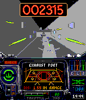
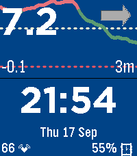
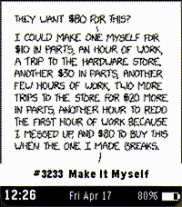

---
hide:
  - toc
---

<!-- Generated by scripts/update_app_directory.py: do not edit by hand -->
# Pebble Watchfaces: X

[← All Pebble Watchfaces](../watchfaces.md) · [A](a.md) · [B](b.md) · [C](c.md) · [D](d.md) · [E](e.md) · [F](f.md) · [G](g.md) · [H](h.md) · [I](i.md) · [J](j.md) · [K](k.md) · [L](l.md) · [M](m.md) · [N](n.md) · [O](o.md) · [P](p.md) · [Q](q.md) · [R](r.md) · [S](s.md) · [T](t.md) · [U](u.md) · [V](v.md) · [W](w.md) · **X** · [Y](y.md) · [Z](z.md) · [0–9 & other](other.md)

*10 watchfaces · Last updated 2026-10-12 · [About these lists](../about-app-lists.md)*

<h2 class="app-name" id="app-54cc6b410a912f389e00007c"><a href="https://apps.repebble.com/54cc6b410a912f389e00007c">X-Factor</a> v1.3</h2>
<a class="app-source" href="https://github.com/Jaeman1999/xfactor" title="Source code" data-search-exclude>View source</a>

by <a href="../developers/jeremy-ketterer.html" title="More from this developer">Jeremy Ketterer</a>

No licence Released 2015-01-31 Updated 2015-04-20

Runs on: Time 2, Pebble 2 Duo, Pebble 2, Time, Classic

Simple watchface with a jagged design. Displays time in 12h format, month, date, and day of the week.

<h2 class="app-name" id="app-55c2f6b2740436377400007d"><a href="https://apps.repebble.com/55c2f6b2740436377400007d">X-wing</a> v0.83</h2>
<a class="app-source" href="https://github.com/miloprice/pebble-xwing" title="Source code" data-search-exclude>View source</a>

by <a href="../developers/milo-price.html" title="More from this developer">Milo Price</a>

Released 2015-08-06 Updated 2015-08-27

Runs on: Time 2, Time

Relive the climactic Trench Run from Star Wars! This watchface features imagery from the final assault on the Death Star from the 1993 X-wing DOS game by LucasArts. Current features: - Time shown…

<h2 class="app-name" id="app-692bf93b63df8c000980a4c0"><a href="https://apps.rebble.io/en_US/application/692bf93b63df8c000980a4c0">xclock</a> v1.1.0</h2>
<a class="app-source" href="https://github.com/kjy00302/pebble-xclock" title="Source code" data-search-exclude>View source</a>

by <a href="../developers/kjy00302.html" title="More from this developer">kjy00302</a> · <a href="https://forum.rebble.io/t/1162" title="Discuss this app on the Rebble forum" data-search-exclude>Forum thread</a>

Released 2025-11-30 Updated 2026-07-17 Rebble App Store

Runs on: Round 2, Time 2, Pebble 2 Duo, Pebble 2, Time Round, Time, Classic

The classic analog clock for X windows system, ported to Pebble watchface.

<h2 class="app-name" id="app-8e71e4d1e67a4f9d8e27fa0e"><a href="https://apps.repebble.com/8e71e4d1e67a4f9d8e27fa0e">xDrip Framework Demo Watch Face</a> v1.0.3</h2>
<a class="app-source" href="https://github.com/jstevensog/xDrip-Pebble-E/" title="Source code" data-search-exclude>View source</a>

by <a href="../developers/jstevensogt1d.html" title="More from this developer">JStevensogT1D</a>

Released 2026-09-11 Updated 2026-10-01

Runs on: Round 2, Time 2, Pebble 2 Duo, Pebble 2, Time Round, Time, Classic

This is a demonstration version of a watch face designed to operate with the xDrip experimental Type 1 Diabetes management phone app. Note that currently this is not supported in the mainstream…

<h2 class="app-name" id="app-254e66f253cd44edaf11e5d2"><a href="https://apps.repebble.com/254e66f253cd44edaf11e5d2">Xenoblade Chronicles</a> v1.2.3</h2>
<a class="app-source" href="https://github.com/MK73DS/xenoblade_watchface" title="Source code" data-search-exclude>View source</a>

by <a href="../developers/mk73ds.html" title="More from this developer">MK73DS</a> · <a href="https://forum.rebble.io/t/1294" title="Discuss this app on the Rebble forum" data-search-exclude>Forum thread</a>

No licence Released 2026-08-23 Updated 2026-09-05

Runs on: Time 2

~~ Xenoblade Chronicles watchface for Pebble Time 2 ~~ A Pebble watchface for the Pebble Time 2 only, featuring a beautiful theme from the video game Xenoblade Chronicles! =&gt; Features - Time and…

<h2 class="app-name" id="app-8d0aa31ae4834764be9292b9"><a href="https://apps.repebble.com/8d0aa31ae4834764be9292b9">Xeric Jump Hour</a> v1.2</h2>
<a class="app-source" href="https://github.com/shapeepo/xeric-jump-hour" title="Source code" data-search-exclude>View source</a>

by <a href="../developers/shapeepo.html" title="More from this developer">Shapeepo</a>

Released 2026-04-30 Updated 2026-04-30

Runs on: Round 2, Time 2, Pebble 2 Duo, Pebble 2, Time Round, Time, Classic

Based on Xeric Retroscope Jump Hour (designed with help from claude code, wip)

<h2 class="app-name" id="app-5567f5e4dd469916f300009d"><a href="https://apps.repebble.com/5567f5e4dd469916f300009d">XEVI NUMBER</a> v1.0</h2>
<a class="app-source" href="https://github.com/taturou/pebble_Xevious" title="Source code" data-search-exclude>View source</a>

by <a href="../developers/taturou.html" title="More from this developer">taturou</a>

Released 2015-05-29 Updated 2015-05-29

Runs on: Time 2, Time

The Xevious number clock.

<h2 class="app-name" id="app-b68b8fba9a664893a9d16a25"><a href="https://apps.repebble.com/b68b8fba9a664893a9d16a25">XKCD Daily</a> v1.0.1</h2>
<a class="app-source" href="https://github.com/coredevices/pebble-watchface-agent-skill" title="Source code" data-search-exclude>View source</a>

by <a href="../developers/aircodum.html" title="More from this developer">AirCodum</a>

No licence Released 2026-04-17 Updated 2026-04-17

Runs on: Time 2

The current XKCD comic, refreshed hourly. Shake your watch to reveal the alt-text caption - the hover-text joke behind each comic.

<h2 class="app-name" id="app-5497633d83524456ec000039"><a href="https://apps.repebble.com/5497633d83524456ec000039">XO</a> v1.2</h2>
<a class="app-source" href="https://github.com/cscott/pebble-xo" title="Source code" data-search-exclude>View source</a>

by <a href="../developers/cscott.html" title="More from this developer">cscott</a>

No licence Released 2014-12-22 Updated 2015-06-24

Runs on: Time 2, Pebble 2 Duo, Pebble 2, Time, Classic

A simple watchface displaying the One Laptop per Child/Sugar &quot;XO man&quot;.

<h2 class="app-name" id="app-53a59b119580ed5b6300014e"><a href="https://apps.repebble.com/53a59b119580ed5b6300014e">XTERN</a> v1.0.0</h2>
<a class="app-source" href="https://github.com/vidia/xtern" title="Source code" data-search-exclude>View source</a>

by <a href="../developers/vidia.html" title="More from this developer">Vidia</a>

Released 2014-06-21 Updated 2014-06-21

Runs on: Time 2, Pebble 2 Duo, Pebble 2, Time, Classic

Xtern, the ultimate tech internship experience. Xtern is an initiative of IndyX which gathers talented interns to work at Indianapolis, IN&#x27;s fastest growing tech companies. Intens live together in…

